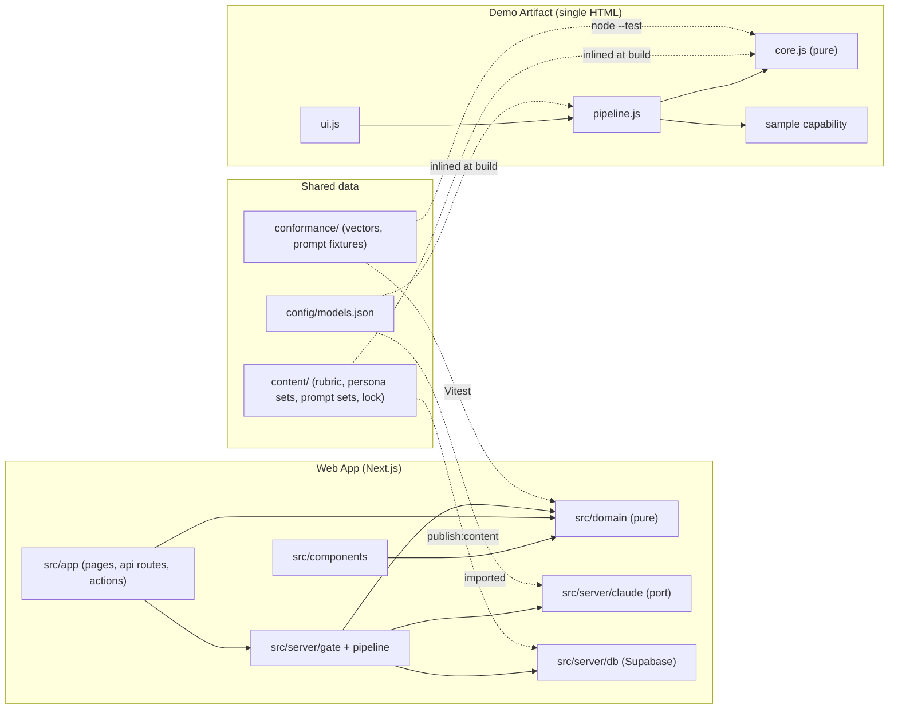
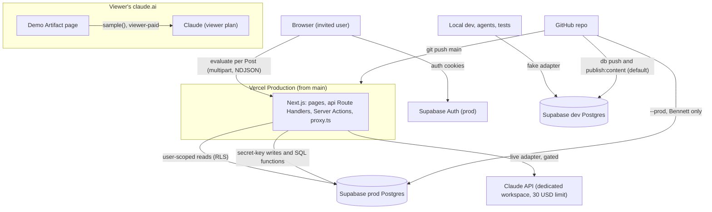
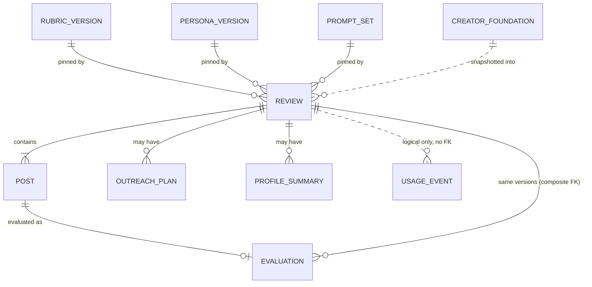

# ARCHITECTURE: Living Letter

Promoted 2026-10-21 from the `bmad-architecture` run [`_bmad-output/planning-artifacts/architecture/architecture-FC-Final-Project-2026-10-21/`](_bmad-output/planning-artifacts/architecture/architecture-FC-Final-Project-2026-10-21/ARCHITECTURE-SPINE.md). Decision rationale is in that folder's `.memlog.md`; the review-gate reports are in its `reviews/`. Data contracts are in [`SCHEMA.md`](SCHEMA.md). This file is the contract: change it through a new `bmad-architecture` update run (keeping AD ids stable), never by hand in an implementation brief.

## Design Paradigm

**Functional core, imperative shell.** Judgement lives in versioned data (`content/`). Arithmetic, validation, prompt rendering, ordering and redaction are pure functions. Each surface is a thin shell that does I/O: it calls Claude, validates the result, persists it (Web App only) and renders it.

The two surfaces share **data, never code**:
- `content/`
- `conformance/`
- `config/models.json`
- the contracts in `SCHEMA.md` §3–§4

Parity between the two shells is enforced by running the same conformance vectors against both (AD-16).

| Layer | Demo Artifact | Web App | May depend on |
|---|---|---|---|
| Shared data | inlined at build | `content/` → version tables; `config/`, `conformance/` imported | nothing |
| Core (pure) | `artifact/src/core.js` | `src/domain/` | shared data shapes |
| Shell: model access | `sample` capability | `src/server/claude/` (port + live/fake adapters) | core |
| Shell: persistence | none (page memory) | `src/server/db/` (Supabase) | core |
| Shell: orchestration | `artifact/src/pipeline.js` | `src/server/gate/`, `src/server/pipeline/` | core, model access, persistence |
| UI | `artifact/src/ui.js` | `src/app/` (pages, `api/` Route Handlers, Server Actions), `src/components/`, `src/proxy.ts` | core; `src/app` also calls orchestration |



## Invariants & Rules

### AD-1 — Content is immutable, versioned data with one source [ADOPTED]

- **Binds:** FR-7, FR-20, FR-21, both surfaces
- **Prevents:** the two surfaces shipping different text under one version id, and a published version changing under saved Evaluations.
- **Rule:**
  - **Files:** content lives only in `content/`:
    - `content/rubric/witness-rubric@<n>.json`
    - `content/personas/persona-set@<n>.json`
    - `content/prompts/prompts@<n>/`, holding `manifest.json`, `guardrails.md`, `assess.md`, `react.md`, `discuss.md`, `rewrite.md`, `outreach.md` and `profile-summary.md`

    A change is a new file, or a new directory, with the next `<n>`.
  - **Lock file:** `content/published.lock.json` (committed) maps every locked id to the SHA-256 of its canonical bytes.
    - **Canonical bytes:** UTF-8, LF line endings, no BOM. For a prompt set, the bytes are `<filename>\n<file bytes>\n` concatenated in ascending filename order.
    - `.gitattributes` sets `content/** text eol=lf`.
  - **Draft and locked ids:**
    - An id with no lock entry is a **draft**. It may be edited, it is never published to a database, and only a local Artifact build may inline it, with its label ending `-draft`.
    - An id becomes **locked** the first time it is inlined into a published Artifact or published to prod.
    - A locked file is never edited. `artifact/build.mjs`, `publish:content` and the check command recompute every locked hash and fail on any mismatch.
  - **Web App reads:** the Web App reads versions only from `rubric_version`, `persona_version` and `prompt_set`, which `npm run publish:content` fills. That script:
    - reads the existing `(id, content_sha256)` rows;
    - fails on any differing hash;
    - then inserts every new row with plain `INSERT` in one transaction, never upsert.
  - **Immutability:** a database trigger rejects UPDATE, DELETE and TRUNCATE on all three tables.
  - **Latest:** "latest" means the highest `<n>` per name.

### AD-2 — Two-step Evaluation pipeline with a fixed input list per call [ADOPTED]

- **Binds:** FR-4, FR-6, FR-8, FR-11, FR-12, FR-13, FR-14, FR-16, both surfaces
- **Prevents:**
  - Persona Reactions feeding Rubric Scores (PRD §4.3);
  - doctrine-correcting rewrites (FR-6, FR-11);
  - Target Audiences skewing scores (FR-10);
  - each surface inventing its own call graph or inputs.
- **Rule:**
  - **Step 1, in parallel:** **Assess** and **React**. Neither receives the other's output.
  - **Step 2, in parallel,** after step-1 derivation (AD-3): **Discuss** always runs. **Rewrite** runs when `rewrite_mode = auto`, or on the "Suggest a gentler version" action (`offer`).
  - **Review-level calls:**
    - **Outreach** (FR-13) runs on Others' Reviews only.
    - **Profile Summary** (FR-14) runs per AD-3.
  - **Inputs.** This list is exhaustive. Anything not listed is never sent.

    | Call | Receives |
    |---|---|
    | Assess | rubric criteria; Post: `pasted_text`, `video_transcript`, images; on an Own-Content Review, `self_presentation` only |
    | React | `personas[]`; Post: `pasted_text`, `video_transcript`, images |
    | Discuss | rubric criteria; `personas[]`; Post text (`pasted_text`, `video_transcript`, `post_transcript`); assessment (post-override, with Soundness Flag); reactions; `lands_well`; `rewrite_mode` |
    | Rewrite | as Discuss, with `soundness_flag` removed by code |
    | Outreach | per Post: `position`, Post text, assessment with `soundness_flag` removed, reactions |
    | Profile Summary | the code-computed `stats` (AD-3) and per-Post assessments with `soundness_flag` removed |

  - **Never sent to any call:**
    - images, outside step 1;
    - `target_audiences`;
    - Source URLs;
    - anything from another Review.

### AD-3 — Arithmetic is code: derive once, store, never recompute [ADOPTED]

- **Binds:** FR-4, FR-5, FR-10, FR-11, FR-14, FR-19, both surfaces
- **Prevents:** the two surfaces disagreeing about whether a Post lands well (in plain JS, `null < 3` is true), a reopened Review changing, and thresholds drifting with model mood.
- **Rule:**
  - **Order, on both surfaces:** parse → shape-validate → overrides → cross-field validate → derive → step 2.
  - **Override:** on an Others' Review, every Criterion whose `applies_to` is `own_content` is forced to N/A, with the rubric's `na_reason_others`. Criteria are identified by `applies_to`, never by number or key.
  - **Thresholds:** let *S* be the non-null scores after the override. N/A never enters a comparison. Thresholds come from the pinned rubric's `thresholds` (v1: 3).
    - *S* empty → `rewrite_mode = not_assessable` and `lands_well = false`. The Evaluation says nothing could be assessed.
    - `lands_well` = min(*S*) ≥ 3.
    - `rewrite_mode`:
      - `auto` if min(*S*) < 3;
      - `offer` if min(*S*) = 3;
      - `none` if min(*S*) ≥ 4.
  - **Lands-well display:** a Post that lands well shows "likely to land well" and no concerns list. Criteria scored 3 show their Evidence without concern styling (FR-5).
  - **Persona display order:**
    - The default order is the order of `personas[]`.
    - On an Own-Content Review, for each Target Audience in `foundation_snapshot` rank order, append its `lead_personas` not already listed. Then append the rest in default order.
    - Unknown keys are skipped. The order affects display only.
  - **Profile Summary:**
    - **Eligibility:** generated once, automatically, for a profile Review (`review.source_url` set) when every Post is terminal and at least 2 are `done`.
    - **`stats`, computed in code:**
      - `post_ids`
      - Criterion averages over *S*
      - Posts per Offence Source
      - Posts below 3 per Criterion
      - Persona valence tallies
      - Strongest and weakest Post: highest and lowest mean of *S*. Ties go to the lower position. Posts with an empty *S* are excluded.
    - **Model output:** only the narrative.
  - **Storage:** `lands_well`, `rewrite_mode` and `stats` are computed once and stored. Renders never recompute them.

### AD-4 — Every model output is validated at the shell boundary and rendered as text

- **Binds:** both surfaces
- **Prevents:** malformed, partial or markup-bearing output reaching the screen or the database, and the two validators accepting different outputs.
- **Rule:**
  - **Validation:** the rules in `SCHEMA.md` §4 bind both surfaces. Objects are strict, and unknown keys are rejected.
    - The local validator is the real gate, because API structured outputs cannot express the counts or ranges.
    - The Artifact extracts JSON as the substring from the first `{` to the last `}`.
  - **Errors:**
    - Invalid output, or a `max_tokens` stop → `invalid_model_output`.
    - A final refusal → `refused`, which is terminal. On the Web App that is `stop_reason: refusal` after fallback; on the Artifact, the `sample` rejection code `refused`.
  - **Retries:**
    - There are no automatic retries. The SDK runs with `maxRetries: 0`, and the Artifact never loops.
    - Try again is manual. On the Artifact it passes `cache: false`.
  - **Rendering:** model output, Post text and Source URLs render as text nodes only. A Source URL that passed the `https?://` check may render as a link with `rel="noopener noreferrer"`.
  - **Additive contracts:**
    - New optional fields go at the end.
    - A breaking change ships with a new `prompts@n`.
    - The Web App keeps validators for every prompt set a saved Review pins.

### AD-5 — Untrusted input and third-party privacy (resolves OQ-5 screenshots) [ADOPTED]

- **Binds:** FR-1, FR-19, PRD §7.2, §7.5, both surfaces
- **Prevents:**
  - user or model text acting as instructions;
  - follower or commenter names being stored or displayed;
  - unbounded inputs blowing the spend cap.
- **Rule:**
  - **Data, not instructions:**
    - Everything derived from user input appears only after all instructions, as JSON inside a fixed tag: `<post>`, `<creator_foundation>`, `<assessment>`, `<reactions>` or `<evaluations>`. That covers Post text, transcripts, `post_transcript`, `self_presentation`, and every earlier model output.
    - Every `<` and `>` inside data is written as `&lt;` / `&gt;`.
    - Templates name the tags and declare their contents material to evaluate, never instructions.
    - Images follow the text in the same user turn.
  - **No third-party names:**
    - Every prompt carries the guardrail "ignore comment sections; never quote, name or describe a follower or commenter" (AD-14).
    - Before persisting or rendering, each shell runs `redactHandles` over every model-output string. Each `@handle` other than the poster's (parsed from the Source URL, when present) becomes `@[name removed]`.
    - Bare names are an accepted residual risk.
  - **Screenshots are transient:**
    - The Artifact holds them in page memory.
    - The Web App receives them in the evaluate request and discards them after step 1.
    - They are never written to Postgres, Supabase Storage, Vercel Blob or logs. A Post keeps only `image_count`.
  - **Screenshots are never rendered as images** after selection. Intake shows file-name chips. "The original" beside a Gentler Rewrite is `pasted_text`, or else `post_transcript`.
  - **Intake limits, on both surfaces:**
    - ≤ 10 Posts per Review.
    - ≤ 4 screenshots per Post. On the Artifact, `min(4, limits().images.maxCount)`.
    - Each screenshot is downscaled in the browser to ≤ 1568 px on the long edge as JPEG. This keeps the request within its byte budget; it is not a model limit.
    - `pasted_text` ≤ 4,000 chars and `video_transcript` ≤ 20,000.
    - A Source URL must be ≤ 2,048 chars and match `https?://`.
  - **Video:** no surface accepts video or audio files. A video Post is a pasted transcript plus optional screenshots.

### AD-6 — Provenance travels with every Evaluation [ADOPTED]

- **Binds:** FR-7, FR-15, FR-19, FR-21, both surfaces
- **Prevents:** saved Evaluations with unknown or mixed versions, labels naming a model that never answered, and cross-version score comparison.
- **Rule:**
  - **Version pins:** a Review pins `rubric_version_id`, `persona_version_id` and `prompt_set_id`, the latest triple, read in one statement at creation. Every Evaluation carries the same triple, enforced by a composite foreign key.
  - **Model provenance:** recorded per call as the answering model: `response.model` on the Web App, `modelApplied` on the Artifact. It is never the requested constant.
    - An Evaluation stores `models {assess, react, discuss, rewrite?}`.
    - The label shows the Assess model, plus "(mixed)" when the calls differ.
  - **Model picker:** the Artifact locks the picker once a Review has Posts.
  - **Creator Foundation:** an Own-Content Review stores `foundation_snapshot` at creation.
  - **Label:** `witness-rubric@n · persona-set@n · prompts@n · <model>`.
  - **Comparison:** scores are compared only within one Rubric Version.

### AD-7 — Claude access boundary; one source of model ids

- **Binds:** both surfaces, RULES.md stack rules
- **Prevents:** keys or the SDK reaching client bundles, model ids scattered across files, real spend during development, and URL-reading tools.
- **Rule:**
  - **Model ids and prices:** `config/models.json` is the only place a model id or a price appears. It holds:
    - `default`: `claude-opus-5-5`;
    - the Artifact picker list: Opus 5.5, Sonnet 5.5 and Haiku 5.5, with `sample` tiers `complex`, `default` and `quick`;
    - the per-MTok price of every model that can answer either surface.

    `src/server/claude/model.ts` imports it as `CLAUDE_MODEL`. `artifact/build.mjs` inlines it.
  - **Web App:**
    - Claude is called only from `src/server/claude/`, through `ClaudePort`, which has a live adapter and a fake adapter.
    - **Live call:** `client.beta.messages.parse`, with:
      - `output_config: { effort: CLAUDE_EFFORT ("medium"), format: betaZodOutputFormat(schema) }`;
      - `fallbacks: "default"`;
      - `betas: [FALLBACK_BETA = "server-side-fallback-2026-07-01"]`;
      - `max_tokens` from a per-step constant.

      The SDK client runs with `maxRetries: 0`.
    - **Fake adapter:** returns conformance-valid fixtures and reports its model as `fake`.
  - **Enforcement:**
    - Every `src/server/**` module imports `server-only`, and a test scans for it.
    - ESLint `no-restricted-imports` forbids `@anthropic-ai/sdk` outside `src/server/claude/`, and `@/server/*` in `src/components/`.
  - **Artifact:** Claude is called only through `sample()`, not `sample.json`, so `modelApplied` is returned. The call uses the picked model, with its tier as the fallback.
  - **No tools:** no call on either surface enables any tool: no web fetch, no web search, no server or page tools.

### AD-8 — Spend control: one gate, a ledger, a backstop (resolves FR-23) [ADOPTED]

- **Binds:** FR-18, FR-23, Web App
- **Prevents:** any Web App Review running without Bennett's permission, unbounded spend per account or per Review, and an under-counting ledger.
- **Rule:**
  - **One gate per unit of work.** A unit is Review creation, one evaluate, one on-demand Rewrite, one Outreach Plan or one Profile Summary. The gate runs in this order:
    1. `unauthenticated`
    2. Input validation: `invalid_request`, `too_many_posts`, `payload_too_large`
    3. Ownership: `not_found`
    4. `reviews_paused`, when `REVIEWS_ENABLED !== "true"`
    5. `monthly_cap_reached`, when month-to-date `sum(usage_event.cost_usd)` since 00:00 UTC on the 1st ≥ `MONTHLY_SPEND_CAP_USD = 25`
    6. Review creation only: `daily_cap_reached`, when the user has ≥ `DAILY_REVIEW_CAP = 3` `review_created` rows in the rolling 24 h. `retry_at` = the oldest of those + 24 h.

    Calls inside an admitted unit are not re-gated. Cap queries use the secret-key client, and any query error refuses: caps never fail open.
  - **Per-unit limits:**
    - `MAX_ATTEMPTS_PER_POST = 3`.
    - `MAX_REGENERATIONS_PER_REVIEW = 3`, for Outreach Plans and for Profile Summaries.
  - **Ledger:** `usage_event` is append-only and has no foreign keys.
    - `review_created` is written inside `create_review` (AD-9).
    - One row per Claude call is written as soon as the response arrives, before parsing, whatever the stop reason.
    - Cost is the sum of `usage.iterations`, each priced at its answering model's rate. An unknown model is priced at the highest rate in `config/models.json`.
    - A call that throws without usage is recorded at the step's worst case.
    - Fake-adapter rows cost 0.
  - **Backstop:**
    - The Web App key lives in a dedicated, non-default Anthropic workspace with a $30 monthly spend limit.
    - That workspace's 400 "workspace API usage limits" response maps to `monthly_cap_reached`.
    - Bennett must confirm the limit in the Console before `REVIEWS_ENABLED=true` is set.
  - **Off-switch operation:** Vercel applies environment changes only on redeploy. Pausing means setting `REVIEWS_ENABLED=false` and redeploying.
  - **Agent rule:**
    - Only Bennett sets `REVIEWS_ENABLED`, and only in Vercel Production.
    - Agents never set `CLAUDE_ADAPTER=live`, never hold `ANTHROPIC_API_KEY` locally, and never make a live Claude call from the Web App without Bennett's explicit OK in chat.
  - **Cost basis:** about $0.25 per Post, or about $2.50 per 10-Post Review, on Opus 5.5 (estimate).

### AD-9 — Data access: verified user, owned targets, server-only atomic writes

- **Binds:** FR-15, FR-18, FR-19, SCHEMA.md RLS, Web App
- **Prevents:** forged identities, cross-user writes through the secret key, cap bypass via direct REST calls, and half-written Reviews or Evaluations.
- **Rule:**
  - **Identity:**
    - Server code derives the user only from `supabase.auth.getClaims()`. Lint bans `getSession(` in `src/`.
    - Every Route Handler and Server Action re-verifies. None relies on the proxy matcher.
  - **Browser:** uses Supabase only for the auth session. It never queries tables.
  - **Reads:** go through the user-scoped client under RLS, which returns own rows only. The exception is `usage_event`, which only the gate reads, with the secret key.
  - **Writes:**
    - Every write to every table, including `creator_foundation`, goes through `src/server/db/` with the secret key, after the gate and Zod validation.
    - Every mutation of an existing row first loads its target through the user-scoped client, or carries `user_id = <verified uid>` in its `WHERE`. A miss returns `not_found`.
  - **Atomic writes:** each multi-row write is one SQL function, executable only by `service_role`:
    - `create_review` takes an advisory lock per user, checks the daily cap, reads the latest version triple, and inserts the Review, its Posts and the `review_created` row. Posts are inserted only with their Review.
    - `record_evaluation` inserts the Evaluation and sets `post_transcript` and `status = done`.
  - **Deletes:**
    - A user deletes their own Reviews, which cascades.
    - Account deletion means Bennett deletes the auth user, which cascades. The ledger keeps uuids only.
  - **RLS:** every table has RLS and explicit policies (`SCHEMA.md` §5). `usage_event` has a restrictive deny-all policy.

### AD-10 — The Post is the unit of work

- **Binds:** FR-1, FR-11, NFR latency, both surfaces
- **Prevents:**
  - request bodies exceeding transport limits;
  - double-paid or stuck evaluations;
  - one failing Post sinking a Review;
  - the surfaces rendering differently.
- **Rule:**
  - **Route Handlers:** every Web App endpoint that calls Claude is a Route Handler under `src/app/api/` with `export const maxDuration = 300`:
    - `POST /api/posts/[postId]/evaluate`
    - `POST /api/evaluations/[id]/rewrite`
    - `POST /api/reviews/[id]/outreach`
    - `POST /api/reviews/[id]/profile-summary`
  - **Evaluate body:** `multipart/form-data` with exactly `image_count` JPEG parts, at most 4, and a total body ≤ 4.0 MB. The browser steps JPEG quality down from 0.85 until it fits.
  - **Server Actions** only create Reviews, save the Creator Foundation, and delete Reviews.
  - **In flight:** the browser sends one evaluate request per Post.
    - Web App: at most 2 in flight. The server also rejects a claim when the user already holds 2 fresh claims.
    - Artifact: 1 in flight.
  - **Rendering per round, on both surfaces:** Assess and React render once both validate; Discuss and Rewrite render after step 2. The Web App evaluate route streams NDJSON:
    1. line 1: the validated step-1 outputs;
    2. line 2: the persisted Evaluation, or an error.
  - **Persistence (Web App):** all-or-nothing, through `record_evaluation`, once every required call has validated.
  - **Post status:**
    - Transitions: `pending → evaluating → done | failed | refused`, plus `failed → evaluating` on Try again.
    - The claim is atomic. It succeeds when the status is `pending` or `failed`, or `evaluating` with `claimed_at` older than 6 minutes, and `attempt` < 3.
    - `done` and `refused` are terminal.
    - Try again re-runs every call, and each is charged again. If the page no longer holds an image Post's screenshots, Try again asks the User to add them again.
  - **On-demand Rewrite:** claims atomically. It requires `rewrite_mode = offer`, no rewrite yet, and no fresh request.
  - **Reopened Review:** `done` Posts are read-only; `pending` and `failed` Posts can be run.

### AD-11 — Sign-in is invite-only [ADOPTED]

- **Binds:** FR-18, Web App
- **Prevents:** strangers creating accounts on an unshared but public URL, and silently expiring sessions.
- **Rule:**
  - **Accounts:**
    - Email + password, with public sign-up disabled.
    - Bennett creates each account in the Supabase dashboard ("Auto Confirm User") and resets passwords there. No email is sent.
    - No account exists for minors.
  - **Sessions:** session cookies are refreshed in `src/proxy.ts`, Next 16's replacement for middleware, through `@supabase/ssr` `createServerClient` + `getClaims()`. Sign-out clears them.
  - **Before first use:** Bennett confirms on the prod project that a dashboard-created user can sign in while sign-ups are off.

### AD-12 — The Demo Artifact is one self-contained page that keeps nothing [ADOPTED]

- **Binds:** FR-1, FR-2, FR-17, FR-20, FR-22, PRD §7.2, Demo Artifact
- **Prevents:** keys, network calls, persisted third-party content, preloaded real posts, or a broken shared link in the published Artifact.
- **Rule:**
  - **Build:** `node artifact/build.mjs` inlines the locked content ids (latest `<n>` of each name), `config/models.json` and `artifact/src/` into `artifact/dist/witness-review.html`, which is git-ignored. Load `artifact-design` before building the page, and `artifact-capabilities` before writing `sample()` code.
  - **Publish:**
    - Through the Artifact tool. The first publish pinned contract `0.2.88`; on 2026-10-26 it moved to the latest contract for `mcp`.
    - Its URL is recorded in `CLAUDE.md` §2, and every later publish passes that `url`.
  - **Capabilities:** exactly `{sample: {images: true}, downloads: true, mcp: {servers: [{server: "Supadata", tools: ["supadata_metadata", "supadata_transcript", "supadata_check_transcript_status"]}]}}`. `downloads` was added 2026-10-21 by Bennett so a viewer can keep a Review; `mcp` was added 2026-10-26 by Bennett for reel transcripts, and `supadata_metadata` on 2026-10-27 for captions and the post type (AD-13).
  - **Persistence:** Reviews, Posts and screenshots live in page memory only. `localStorage` holds only per-viewer UI preferences, such as the theme, inside try/catch.
  - **Export:** the viewer may copy the Review as Markdown, or save it as a `.md` file through `downloads.save` after confirming. The saved file adds a raw JSON appendix. Screenshots are never included. The page itself still keeps nothing.
  - **Owner copy editor (owner-only authoring aid, 2026-10-26, Bennett):** Shift+E (ignored while typing) shows a hidden bar (`artifact/src/editor.js`). In edit mode, any element with its own text in the intro and `main` can be rewritten, moved and restyled; page clicks are suppressed except the tabs, and every `<details>` is held open. "Save edits" hands over `copy-edits.json` through the existing `downloads` (clipboard fallback); no storage, no network, no new capability. Bennett commits it as `artifact/copy-edits.json`; `build.mjs` checks it (`artifact/src/copy-edits.js`) and inlines it as `COPY_EDITS`, and the page applies it on load with edit HTML sanitized to an inline-formatting allowlist. Edits match a box by its original text plus occurrence; an edit whose text changed is reported as no longer matching and kept in the next export. How it works edits to `content/` text are a display-only overlay (Bennett, 2026-10-26): Claude still scores with the locked versions, an accepted exception to AD-16's "the page always matches the scoring text". The Review results (`#posts`, `#outreach-slot`) are re-scanned after every render: label edits are saved as `live` edits keyed by text alone and applied to every Post; text `ui.js` marks `.said` (Claude's output or what the viewer pasted) can be retyped on screen but is never saved. Never editable: status and error lines, the versions label.
  - **Network:**
    - Page script makes no fetch or XHR.
    - The only external loads are Google Fonts stylesheets and pinned CDN scripts that the `artifact-design` contract allows.
    - No Source URL is ever fetched by the page. The one exception is AD-13's single-post read, which goes through the viewer's Supadata connector.
  - **Scope:** FR-1, FR-2, FR-4–FR-9, FR-11–FR-13, FR-17, FR-20 and FR-22. The Artifact runs Others' Reviews only, so own-content Criteria show N/A.
  - **Limits:** `limits()` is read at load. `rate_limited`, `not_granted` and `upstream_error` map to per-Post errors with a manual Try again.
  - **Use:** calls happen only on an explicit viewer action, on the viewer's own Claude usage. Built-in examples are fictional.

### AD-13 — No URL is ever read, except one Instagram or TikTok post through Supadata [ADOPTED, amended 2026-10-26 and 2026-10-27]

- **Binds:** FR-2, FR-3, FR-3a
- **Prevents:** any code path, script or model call reading a Post or profile from a URL.
- **Rule:**
  - FR-3 is dropped. TikTok oEmbed returned no caption in the 2026-10-21 test.
  - No surface, script or model call reads a URL, with one exception (FR-3a): in the Demo Artifact, when a Post's Source URL is a single Instagram post or reel or a single TikTok video or photo post (`isReadablePostLink` in `core.js`; reels are often shared as `/p/` links), `artifact/src/reel.js` sends that URL, and only that URL, to the viewer's Supadata connector:
    - `supadata_metadata` first. Its `description` becomes the Post's text when none was pasted. Only a `type` of `image` or `carousel` counts as not a video.
    - For a video, `supadata_transcript` (`text: true`; a `jobId` answer is polled at most 20 times). The result becomes the Post's video transcript.
    - For a carousel or image post, the slide images cannot be read: the page's network is blocked, so it cannot download the image URLs that `supadata_metadata` returns, and `supadata_extract` refuses carousels (tested 2026-10-27). Unless screenshots or typed-out slide text were added (`needsSlides`), the viewer is asked for screenshots of the slides and the Post is not added.
    - A metadata failure falls back to the transcript alone, except a permission answer (`approval_required`, `not_in_manifest`), which stops the read.
  - The UI does not name Supadata. The page runs on the latest runtime contract, since `mcp` did not reach the page on 0.2.88.
  - If the post cannot be read, the Post is still added when it has text or screenshots; otherwise the viewer is asked to paste the transcript or text.
  - Source URLs are display-only and are never sent to a model. Profile URLs are never read.

### AD-14 — PRD tone and content rules live in versioned prompt content

- **Binds:** FR-2, FR-5, FR-6, FR-8, FR-9, FR-11, FR-12, FR-13, FR-14, FR-17, PRD §5, §7.2–§7.4, §7.6, both surfaces
- **Prevents:** a prompt silently omitting a PRD tone or content rule, and model-written versions of mandatory UI copy.
- **Rule:**
  - **`guardrails.md`:** every prompt set has one, rendered into every call after the step's instructions and inside the cached prefix. It carries:
    - feedback is charitable and specific;
    - affirm what is genuinely good before raising concerns;
    - critique the Post, never the person;
    - point to a concrete line and a concrete change;
    - no mockery and no theological verdicts;
    - ignore comment sections, and never name a follower or commenter;
    - Personas are simulated, never real people;
    - never use the word "verdict", and never treat "the non-believer" as one type.
  - **Per-call rules**, each carried in its step file:

    | File | Must carry |
    |---|---|
    | `assess.md` | FR-4: N/A only when nothing can be assessed, with the reason. Tone and jargon lower a score; claim offence is reported and never lowers one. FR-5: do not invent problems; a 3 is not a problem. FR-6: the Soundness Flag is independent of every score. Criterion 9 scores clarity, not correctness |
    | `react.md` | FR-8: speak from the Persona's own experience. Never diagnose motives. No labels such as "idolatry" or "syncretism". Point at specific parts of the Post. Give positive Felt Responses when warranted. The Emboldened Believer describes behaviour toward others |
    | `discuss.md` | FR-12: the four standing questions in canonical wording, adapted to the Post. Questions are open, not leading, and suited to a teenage small group led by an adult. FR-5: no problem framing when the Post lands well |
    | `rewrite.md` | FR-11: keep the main message and convictions. Change only manner, clarity and framing. Never correct doctrine (§6.3). Never write a new post (§5) |
    | `outreach.md` | FR-13: the Jethro-to-Moses model (addendum §D). Open with genuine affirmation of something real. Raise at most 3 concerns, each with why it matters and one concrete change. No mockery, no theological verdict, and no claim that the Personas are real. Written for the Introducer to send themselves |
    | `profile-summary.md` | FR-14: quantify patterns only from the supplied `stats`. Refer to Personas as simulated |

  - **Rule markers:** each rule is marked `<!-- rule:<id> -->`. `manifest.json` lists the required markers per file. `build.mjs` and the test suite fail when one is missing.
  - **Fixed UI copy:** these strings are constants on both surfaces, never model output. `bmad-ux` owns the wording.
    - a "Simulated perspective" label wherever Persona content appears: reaction cards, Discussion Questions and Talking Points that cite a Persona, and Profile Summary Persona rows;
    - the FR-2 notice that links can't be read;
    - the FR-6 note "a prompt for discussion with a leader, not a ruling";
    - the FR-11 "Suggestion" label;
    - the FR-17 reminder;
    - the Bonhoeffer line, only as "commonly attributed to Bonhoeffer" (§7.6).
  - **No outbound contact:** no code sends anything on a User's behalf. The Outreach Message has a Copy action only.

### AD-15 — Environments and operations [ADOPTED]

- **Binds:** Web App, `publish:content`, migrations
- **Prevents:** development writes polluting permanent production tables, Preview builds holding live keys, production serving fixtures, and logs leaking Post text.
- **Rule:**
  - **Supabase:** two free projects.
    - `dev`: local development, agents and tests. `.env.local` holds dev keys and `CLAUDE_ADAPTER=fake`, and no `ANTHROPIC_API_KEY`.
    - `prod`: Vercel Production only.
  - **Database commands:**
    - `supabase db push` and `publish:content` target `dev` by default.
    - They reach `prod` only through an explicit `--prod` (or prod link), run by Bennett or with his OK in chat.
    - A migration reaches `prod` before the code that needs it reaches `main`.
  - **Vercel:**
    - Production deploys from `main`.
    - `ANTHROPIC_API_KEY`, `SUPABASE_SECRET_KEY`, `REVIEWS_ENABLED` and `CLAUDE_ADAPTER=live` are set for Production only. Preview gets no secrets.
    - The server refuses to start when `VERCEL_ENV=production` and `CLAUDE_ADAPTER` is not `live`.
    - `package.json` sets `engines.node` to `24.x`.
    - The plan is Hobby (a personal or course project).
  - **Supabase Free:** it pauses after a week of inactivity and has no automatic backups. Before any demo, Bennett restores `prod` and takes `supabase db dump`. Version tables can be rebuilt from `content/`; saved Reviews cannot.
  - **Logging:**
    - Every Route Handler and Server Action runs inside one error boundary (`src/server/log.ts`).
    - It logs only `{code, step, ids, err.name}`, never `err.message`, causes, Zod issues, SDK bodies, Post text or model prose.
    - ESLint `no-console` applies outside `log.ts`.

### AD-16 — Two shells, one behaviour: rendering and conformance are data

- **Binds:** both surfaces
- **Prevents:** one `prompts@n` label meaning different prompt bytes on the two surfaces, and the two cores computing different results.
- **Rule:**
  - **Prompt rendering:**
    - Each `prompts@n/<step>.md` is a complete template. Its only variable parts are the `{{name}}` placeholders listed in `manifest.json`: `{{guardrails}}`, `{{criteria}}`, `{{personas}}`, `{{foundation}}`, `{{post}}`, `{{assessment}}`, `{{reactions}}`, `{{evaluations}}`, `{{stats}}`.
    - Rendering is literal substitution of the escaped, tagged data (AD-5).
    - **Canonical JSON:** keys in source-file order, 2-space indent, LF. `{{personas}}` holds `personas[]` only.
    - **Turn layout:** both surfaces send the rendered text as one user turn, with no system prompt. The Web App adds the JSON Schema through `output_config.format`, and its cache breakpoint ends after the last static section.
    - The Web App renders from the version tables' `content_text`, never from re-serialised `jsonb`.
  - **`conformance/` (repo root):** vectors as data, covering:
    - thresholds and derivation;
    - valid and invalid outputs per call;
    - persona order;
    - escaping;
    - redaction;
    - intake limits;
    - rendered-prompt byte fixtures per step.
  - **Runners:**
    - `node --test artifact/test/` runs the vectors against `artifact/src/core.js`, from Thursday.
    - Vitest runs them against `src/domain/`, from week 2.
    - Both are in the check command.
    - The fake adapter's fixtures are conformance-valid outputs.

## Consistency Conventions

| Concern | Convention |
| --- | --- |
| Domain naming | Use PRD Glossary terms verbatim: Review, Post, Unpublished Post, Evaluation, Rubric Version, Criterion, Rubric Score, Evidence, Persona Version, Persona Reaction, Felt Response, Offence Source, Gentler Rewrite, Soundness Flag, Discussion Questions, Ministry Outreach Plan, Outreach Message, Talking Point, Profile Summary, Creator Foundation, Target Audience, Draft Checkpoint, Others' Review, Own-Content Review, Source URL. DB tables are snake_case singular; TS types are PascalCase. Never "verdict", never "artifact" for model output, never "the non-believer" as one type |
| Content keys | snake_case slugs fixed by their version file. Persona keys: `seeker`, `drifter`, `neighbor_other_faith`, `exvangelical`, `skeptic`, `progressive`, `emboldened_believer`. Target Audience keys: `curious`, `dechurched`, `other_faiths`, `secular`, `believers`. Criterion keys follow the same style (e.g. `outsider_clarity`). Version ids are `<name>@<n>` |
| IDs, time, money | Row ids are `uuid` (`gen_random_uuid()`). Times are `timestamptz` UTC, with ISO 8601 in JSON. Money is `numeric(10,6)` USD, priced from `config/models.json` |
| Server error shape | `{ "error": { "code": string, "message": string, "retry_at"?: string } }`. Codes: `unauthenticated`, `invalid_request`, `too_many_posts`, `payload_too_large`, `not_found`, `conflict`, `foundation_required`, `reviews_paused`, `monthly_cap_reached`, `daily_cap_reached`, `invalid_model_output`, `refused`, `rate_limited` (Artifact), `upstream_error`. `message` is fixed copy, never model or user text |
| Config (Web App env) | Server only: `ANTHROPIC_API_KEY`, `SUPABASE_SECRET_KEY` (`sb_secret_…`). Public: `NEXT_PUBLIC_SUPABASE_URL`, `NEXT_PUBLIC_SUPABASE_PUBLISHABLE_KEY` (`sb_publishable_…`). `REVIEWS_ENABLED` (unset means false). `CLAUDE_ADAPTER` (`fake` by default; `live` in Production only) |
| Scaffold (week 2) | `npx create-next-app@16.4.2 <empty temp dir> --ts --eslint --tailwind --app --src-dir --turbopack --import-alias "@/*" --no-react-compiler --no-cache-components --no-agents-md --no-agent-feedback --use-npm`. Then move the result into the repo root without overwriting `AGENTS.md`, `CLAUDE.md`, `README.md` or `.gitignore` (merge it, keeping `.env*` ignored). Add the scripts `typecheck` (`tsc --noEmit`) and `test` (`vitest run`), `engines.node: "24.x"`, and `@types/node` ^24. `vitest.config` aliases `server-only` to an empty module. `scripts/` never imports `src/server/` |
| Lint (week 2) | `@typescript-eslint/no-explicit-any: error` in `src/`; a ban on `getSession(`; `no-console` outside `src/server/log.ts`; `no-restricted-imports` per AD-7 |
| Check command | Thursday (no `package.json` yet): `node --test artifact/test/ && node artifact/build.mjs`. From week 2: `npm run lint && npm run typecheck && npm run test && npm run build && node --test artifact/test/ && node artifact/build.mjs` |

## Stack

| Name | Version |
| --- | --- |
| Node.js (local + Vercel functions) | 24.x |
| Next.js (App Router, Turbopack, `src/` dir, Cache Components off) | 16.4.2 |
| React / React DOM (exact pin written by create-next-app 16.4.2) | 19.3.0 |
| TypeScript (strict; capped below 6.1 by typescript-eslint's peer range) | 5.9.3 |
| ESLint (end-of-life upstream; forced by eslint-config-next 16.4.2's plugin peers; dev-only) | 9.39.5 |
| eslint-config-next | 16.4.2 |
| Tailwind CSS (create-next-app default; tokens owned by DESIGN.md) | 4.3.3 |
| @anthropic-ai/sdk | 0.137.0 |
| @supabase/supabase-js | 2.118.0 |
| @supabase/ssr | 0.12.7 |
| Supabase CLI (migrations, `db dump`) | 2.121.0 |
| zod | 4.6.7 |
| vitest | 5.0.5 |
| vite (vitest peer) | 8.3.5 |
| @types/node | 24.19.2 |
| server-only | 0.0.1 |
| Claude model (default, both surfaces) | claude-opus-5-5 |
| Server-side fallback beta header | server-side-fallback-2026-07-01 |
| Artifact runtime contract (`sample`) | 0.2.88 |
| Hosting | Vercel Hobby; Supabase Free × 2 (`dev`, `prod`) |

## Structural Seed





```text
FC-Final-Project/
  content/                   # AD-1: versioned data + published.lock.json
    rubric/  personas/  prompts/prompts@1/
  conformance/               # AD-16: shared vectors + rendered-prompt fixtures
  config/models.json         # AD-7: the only model ids and prices
  artifact/                  # AD-12: Demo Artifact
    src/core.js pipeline.js ui.js
    test/                    #   node --test against conformance/
    build.mjs                #   → dist/witness-review.html (git-ignored)
  src/                       # Web App (Next.js 16)
    proxy.ts                 #   AD-11 session refresh
    app/                     #   pages; api/ Route Handlers (AD-10); Server Actions
    components/
    domain/                  #   pure: contracts, derive, render, order, redact, cost
    server/                  #   server-only: claude/, db/, gate/, pipeline/, log.ts
  scripts/publish-content.ts # AD-1/AD-15: dev by default, --prod by Bennett
  supabase/migrations/       # SCHEMA.md; append-only once applied
```

## Capability → Architecture Map

| Capability / Area | Surface | Lives in | Governed by |
| --- | --- | --- | --- |
| FR-1 Paste + screenshots + transcript | F + W2 | intake UI on both; browser downscale | AD-5, AD-10 |
| FR-2 Source URL (display only) | F + W2 | Review/Post fields; UI | AD-4, AD-13, AD-14 |
| FR-3 TikTok pre-fill | dropped | — | AD-13 |
| FR-3a Instagram and TikTok post read | F only | `artifact/src/reel.js`; `isReadablePostLink` in `core.js` | AD-12, AD-13 |
| FR-4/5/6 Scores, lands well, Soundness Flag | F + W2 | Assess; `core.js` / `src/domain` derive | AD-2, AD-3, AD-4, AD-14 |
| FR-7 / FR-20 / FR-21 Versions | F + W2 (FR-21 W2) | `content/`, lock file, version tables, publish script | AD-1, AD-6, AD-15 |
| FR-8/9 Persona Reactions, simulated label | F + W2 | React; UI | AD-2, AD-14 |
| FR-10 Persona order by Target Audience | W2 | `persona-set@n.json` `target_audiences[].lead_personas`; order function | AD-3 |
| FR-11 Gentler Rewrite | F + W2 | Rewrite; `/api/evaluations/[id]/rewrite` | AD-2, AD-3, AD-10, AD-14 |
| FR-12 Discussion Questions | F + W2 | Discuss | AD-2, AD-14 |
| FR-13 Ministry Outreach Plan | F + W2 | Outreach (`artifact/src/pipeline.js`; `/api/reviews/[id]/outreach`) | AD-2, AD-8, AD-12, AD-14 |
| FR-14 Profile Summary | W2 | `src/domain` stats + Profile Summary call | AD-2, AD-3 |
| FR-15/16 Creator Foundation, Own-Content, Draft Checkpoint, Criterion 10 | W2 | `creator_foundation`; `review.kind`, `is_draft_checkpoint` | AD-3, AD-6, AD-9 |
| FR-17 "Lands anywhere" reminder | F + W2 | fixed UI copy | AD-14 |
| FR-18 Accounts | W2 | Supabase Auth, `src/proxy.ts` | AD-9, AD-11 |
| FR-19 Saved Reviews | W2 | `review` and its children, reopened | AD-5, AD-6, AD-9, AD-10 |
| FR-22 Roadmap tab | F only | static Artifact tab | AD-12 |
| FR-23 Caps | W2 | `src/server/gate/`, `usage_event` | AD-8 |
| NFR latency / secrets / RLS | both | — | AD-10 / AD-7, AD-15 / AD-9 |
| OQ-5 | both | screenshots (AD-5), caps (AD-8), Artifact calls (AD-12) | — |

## Deferred

- **Latency levers (PRD §8, 60 s per Post), measured Thursday 2026-10-22 on real Posts.**
  - Rendering per round is already decided (AD-10).
  - Candidate levers: Web App step-2 effort `low`; on the Artifact, step 2 on a lower-tier model.
  - Any change amends AD-10 for both surfaces. The planner makes it with Bennett, never inside one surface's build.
- **Cap reservation under concurrency:**
  - Admitted units can overshoot the $25 cap. The worst case is 2 in-flight Posts × the per-Post worst case under the AD-5 input limits, per account.
  - The workspace limit is the hard stop.
  - Revisit if the link is shared widely.
- **Stored screenshots** (crop or redaction): rejected for MVP by AD-5. Revisit only with a guarantee for PRD §7.2.
- **Google OAuth, magic-link sign-in, custom SMTP:** not needed while sign-in is invite-only.
- **Staging, observability beyond Vercel logs, paid backups:** not needed for an unshared demo. Pre-demo `db dump` per AD-15.
- **Database tests (pgTAP for triggers and RLS):** they need a Supabase test target. Revisit once the `dev` project exists.
- **Richer Outreach and Profile Summary lenses** (addendum §D: the design-thinking shape, Keller's postures, the attractional pattern): each enters as a new `prompts@n`, not as code.
- **A Target Audience mapping change** ships as a new `persona-set@n` with unchanged Personas. A separate audiences file would avoid that churn; revisit if it happens.
- **SM-2 re-runs:** on the Artifact, use `cache: false`. On the Web App, they need a live adapter and Bennett's OK.
- **Projector legibility bound (OQ-6, second half):** owned by `bmad-ux`. Binds both UI layers before the Friday recording.
- **OQ-1 prevalence weighting, OQ-2 soundness standard:** product questions, owned by Bennett.
- **Artifact UI framework and visual system:** decided at build by `artifact-design`, with `DESIGN.md`.
