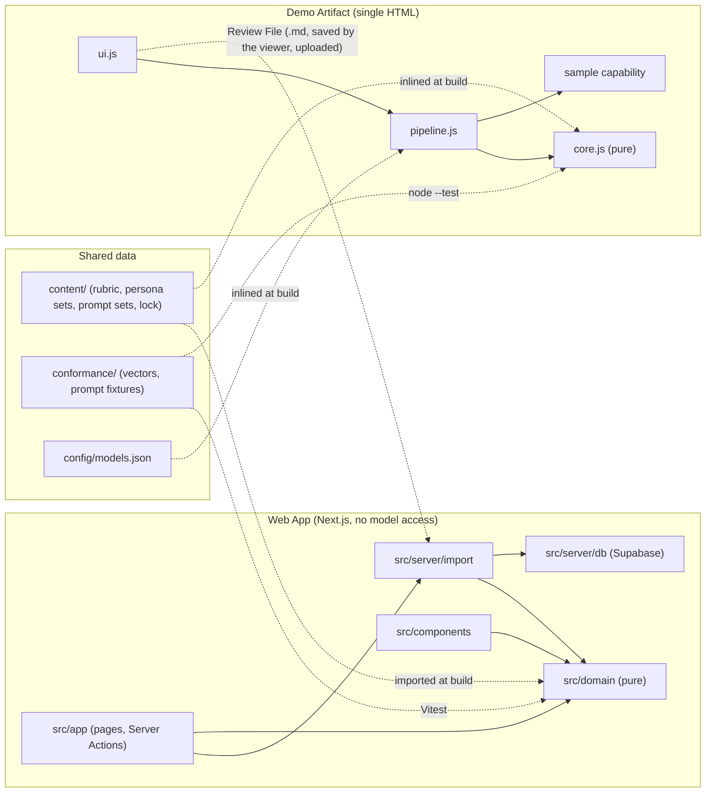
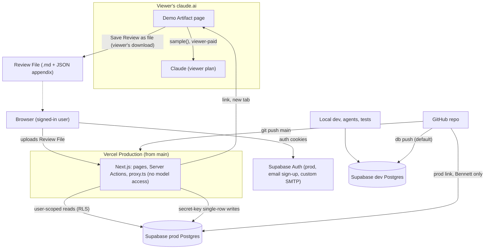
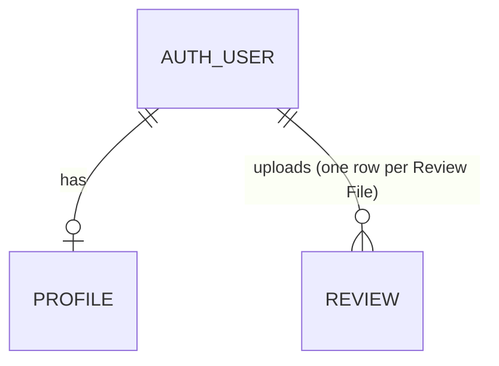

# ARCHITECTURE: Living Letter

Promoted 2026-10-21 from the `bmad-architecture` run [`_bmad-output/planning-artifacts/architecture/architecture-FC-Final-Project-2026-10-21/`](_bmad-output/planning-artifacts/architecture/architecture-FC-Final-Project-2026-10-21/ARCHITECTURE-SPINE.md). Decision rationale is in that folder's `.memlog.md`; the review-gate reports are in its `reviews/`. Data contracts are in [`SCHEMA.md`](SCHEMA.md). This file is the contract: change it through a new `bmad-architecture` update run (keeping AD ids stable), never by hand in an implementation brief.

## Design Paradigm

**Functional core, imperative shell.** Judgement lives in versioned data (`content/`). Arithmetic, validation, prompt rendering, ordering and redaction are pure functions. Each surface is a thin shell that does I/O. The Demo Artifact calls Claude on the viewer's plan, validates the result and renders it. The Web App never calls a model (AD-18): it validates an uploaded Review File, stores it and renders it.

The two surfaces share **data, never code**:
- `content/`
- `conformance/`
- `config/models.json`
- the contracts in `SCHEMA.md` §3–§4

Parity between the two shells is enforced by running the same conformance vectors against both (AD-16).

| Layer | Demo Artifact | Web App | May depend on |
|---|---|---|---|
| Shared data | inlined at build | `content/`, `conformance/` imported at build | nothing |
| Core (pure) | `artifact/src/core.js` | `src/domain/` | shared data shapes |
| Shell: model access | `sample` capability | none (AD-18) | core |
| Shell: persistence | page memory, plus Past Reviews in the viewer’s private `db` subtree (`artifact/src/past.js`) | `src/server/db/` (Supabase) | core |
| Shell: orchestration | `artifact/src/pipeline.js` | `src/server/import/` (Review File → validated row) | core, model access (Artifact), persistence |
| UI | `artifact/src/ui.js` | `src/app/` (pages, Server Actions; no Route Handlers in the MVP), `src/components/`, `src/proxy.ts` | core; `src/app` also calls orchestration |



## Invariants & Rules

### AD-1 — Content is immutable, versioned data with one source [ADOPTED]

- **Binds:** FR-7, FR-20, FR-21, both surfaces
- **Prevents:** the two surfaces shipping different text under one version id, and a published version changing under saved Evaluations.
- **Rule:**
  - **Files:** content lives only in `content/`:
    - `content/rubric/witness-rubric@<n>.json`
    - `content/personas/persona-set@<n>.json`
    - `content/prompts/prompts@<n>/`, holding `manifest.json`, `guardrails.md`, `assess.md`, `react.md`, `discuss.md`, `rewrite.md`, `outreach.md` and `profile-summary.md`

    A change is a new file, or a new directory, with the next `<n>`.
  - **Lock file:** `content/published.lock.json` (committed) maps every locked id to the SHA-256 of its canonical bytes.
    - **Canonical bytes:** UTF-8, LF line endings, no BOM. For a prompt set, the bytes are `<filename>\n<file bytes>\n` concatenated in ascending filename order.
    - `.gitattributes` sets `content/** text eol=lf`.
  - **Draft and locked ids:**
    - An id with no lock entry is a **draft**. It may be edited, it is never published to a database, and only a local Artifact build may inline it, with its label ending `-draft`.
    - An id becomes **locked** the first time it is inlined into a published Artifact or published to prod.
    - A locked file is never edited. `artifact/build.mjs` and the check command recompute every locked hash and fail on any mismatch.
  - **Web App reads (amended 2026-10-30, AD-18):** the Web App imports the locked ids' files from `content/` at build and keeps every locked version, so a Saved Review made with an older version still renders. There are no version tables and no `publish:content`. Publishing a version is a new file plus a redeploy (FR-21).
  - **Latest:** "latest" means the highest `<n>` per name.

### AD-2 — Two-step Evaluation pipeline with a fixed input list per call [ADOPTED]

- **Binds:** FR-4, FR-6, FR-8, FR-11, FR-12, FR-13, FR-14, FR-16, Demo Artifact (since 2026-10-30 the Web App calls no model, AD-18)
- **Prevents:**
  - Persona Reactions feeding Rubric Scores (PRD §4.3);
  - doctrine-correcting rewrites (FR-6, FR-11);
  - Target Audiences skewing scores (FR-10);
  - each surface inventing its own call graph or inputs.
- **Rule:**
  - **Step 1, in parallel:** **Assess** and **React**. Neither receives the other's output.
  - **Step 2, in parallel,** after step-1 derivation (AD-3): **Discuss** always runs. **Rewrite** runs when `rewrite_mode = auto`, or on the "Suggest a gentler version" action (`offer`).
  - **Review-level calls:**
    - **Outreach** (FR-13) runs on Others' Reviews only.
    - **Profile Summary** (FR-14): no model call in the MVP. Both surfaces compute it in code (AD-3); the narrative call is after the MVP.
  - **Inputs.** This list is exhaustive. Anything not listed is never sent.

    | Call | Receives |
    |---|---|
    | Assess | rubric criteria; Post: `pasted_text`, `video_transcript`, images; on an Own-Content Review, `self_presentation` only |
    | React | `personas[]`; Post: `pasted_text`, `video_transcript`, images |
    | Discuss | rubric criteria; `personas[]`; Post text (`pasted_text`, `video_transcript`, `post_transcript`); assessment (post-override, with Soundness Flag); reactions; `lands_well`; `rewrite_mode` |
    | Rewrite | as Discuss, with `soundness_flag` removed by code |
    | Outreach | per Post: `position`, Post text, assessment with `soundness_flag` removed, reactions |
    | Profile Summary | the code-computed `stats` (AD-3) and per-Post assessments with `soundness_flag` removed |

  - **Never sent to any call:**
    - images, outside step 1;
    - `target_audiences`;
    - Source URLs;
    - anything from another Review.

### AD-3 — Arithmetic is code: derive once, store, never recompute [ADOPTED]

- **Binds:** FR-4, FR-5, FR-10, FR-11, FR-14, FR-19, both surfaces
- **Prevents:** the two surfaces disagreeing about whether a Post lands well (in plain JS, `null < 3` is true), a reopened Review changing, and thresholds drifting with model mood.
- **Rule:**
  - **Order, on both surfaces:** parse → shape-validate → overrides → cross-field validate → derive → step 2.
  - **Override:** on an Others' Review, every Criterion whose `applies_to` is `own_content` is forced to N/A, with the rubric's `na_reason_others`. Criteria are identified by `applies_to`, never by number or key.
  - **Thresholds:** let *S* be the non-null scores after the override. N/A never enters a comparison. Thresholds come from the pinned rubric's `thresholds` (v1: 3).
    - *S* empty → `rewrite_mode = not_assessable` and `lands_well = false`. The Evaluation says nothing could be assessed.
    - `lands_well` = min(*S*) ≥ 3.
    - `rewrite_mode`:
      - `auto` if min(*S*) < 3;
      - `offer` if min(*S*) = 3;
      - `none` if min(*S*) ≥ 4.
  - **Lands-well display:** a Post that lands well shows "likely to land well" and no concerns list. Criteria scored 3 show their Evidence without concern styling (FR-5).
  - **Persona display order:**
    - The default order is the order of `personas[]`.
    - On an Own-Content Review, for each Target Audience in `foundation_snapshot` rank order, append its `lead_personas` not already listed. Then append the rest in default order.
    - Unknown keys are skipped. The order affects display only.
  - **Profile Summary (amended 2026-10-30):** computed in code on render, never stored, never by the model, on both surfaces. Its input is the user's Saved Reviews whose three versions equal the latest locked id per name (AD-1): `review` rows on the Web App, Past Reviews in the Artifact.
    - **Retired (2026-10-30):** the per-profile-Review eligibility rule (generated once, automatically, when every Post is terminal and at least 2 are `done`) and the model narrative. Both return with the bring-your-own-key Web App (PRD §6.4).
    - **`stats`, computed in code:**
      - `post_ids`
      - Criterion averages over *S*
      - Posts per Offence Source
      - Posts below 3 per Criterion
      - Persona valence tallies
      - Strongest and weakest Post: highest and lowest mean of *S*. Ties go to the lower position. Posts with an empty *S* are excluded.
  - **Storage:** `lands_well` and `rewrite_mode` are computed once and stored. Renders never recompute them.
  - **Web App (2026-10-30, AD-18):** derived values are recomputed once, at import, only to check the uploaded ones; a mismatch rejects the file. Persona order for a creator follows the Web App profile's ranked audiences (FR-10). The Web App's Profile Summary is the code-computed summary only, as defined above; no model narrative.

### AD-4 — Every model output is validated at the shell boundary and rendered as text

- **Binds:** both surfaces
- **Prevents:** malformed, partial or markup-bearing output reaching the screen or the database, and the two validators accepting different outputs.
- **Rule:**
  - **Validation:** the rules in `SCHEMA.md` §4 bind both surfaces. Objects are strict, and unknown keys are rejected. On the Web App they gate every Evaluation in an uploaded Review File (AD-18), since the file is untrusted.
    - The local validator is the real gate, because API structured outputs cannot express the counts or ranges.
    - The Artifact extracts JSON as the substring from the first `{` to the last `}`.
  - **Errors:**
    - Invalid output, or a `max_tokens` stop → `invalid_model_output`.
    - A final refusal → `refused`, which is terminal. On the Artifact it is the `sample` rejection code `refused`.
  - **Retries:**
    - There are no automatic retries. The Artifact never loops.
    - Try again is manual. On the Artifact it passes `cache: false`.
  - **Rendering:** model output, Post text and Source URLs render as text nodes only. A Source URL that passed the `https?://` check may render as a link with `rel="noopener noreferrer"`.
  - **Additive contracts:**
    - New optional fields go at the end.
    - A breaking change ships with a new `prompts@n`.
    - The Web App keeps validators for every prompt set a saved Review pins.

### AD-5 — Untrusted input and third-party privacy (resolves OQ-5 screenshots) [ADOPTED]

- **Binds:** FR-1, FR-19, PRD §7.2, §7.5, both surfaces
- **Prevents:**
  - user or model text acting as instructions;
  - follower or commenter names being stored or displayed;
  - unbounded inputs blowing the viewer's usage or the Web App's import.
- **Rule:**
  - **Data, not instructions:**
    - Everything derived from user input appears only after all instructions, as JSON inside a fixed tag: `<post>`, `<creator_foundation>`, `<assessment>`, `<reactions>` or `<evaluations>`. That covers Post text, transcripts, `post_transcript`, `self_presentation`, and every earlier model output.
    - Every `<` and `>` inside data is written as `&lt;` / `&gt;`.
    - Templates name the tags and declare their contents material to evaluate, never instructions.
    - Images follow the text in the same user turn.
  - **No third-party names:**
    - Every prompt carries the guardrail "ignore comment sections; never quote, name or describe a follower or commenter" (AD-14).
    - Before persisting or rendering, each shell runs `redactHandles` over every model-output string. Each `@handle` other than the poster's (parsed from the Source URL, when present) becomes `@[name removed]`.
    - Bare names are an accepted residual risk.
  - **Screenshots are transient:**
    - The Artifact holds them in page memory. Past Reviews keep only their file names.
    - The Web App never receives them: a Review File carries only `screenshot_count` (AD-18).
    - They are never written to Postgres, Supabase Storage, Vercel Blob or logs.
  - **Screenshots are never rendered as images** after selection. Intake shows file-name chips. "The original" beside a Gentler Rewrite is `pasted_text`, or else `post_transcript`.
  - **Intake limits (Artifact intake; the Web App enforces the Post, text and URL limits on Review Files, AD-18):**
    - ≤ 10 Posts per Review.
    - ≤ 4 screenshots per Post. On the Artifact, `min(4, limits().images.maxCount)`.
    - Each screenshot is downscaled in the browser to ≤ 1568 px on the long edge as JPEG. This keeps the request within its byte budget; it is not a model limit.
    - `pasted_text` ≤ 4,000 chars and `video_transcript` ≤ 20,000.
    - A Source URL must be ≤ 2,048 chars and match `https?://`.
  - **Video:** no surface accepts video or audio files. A video Post is a pasted transcript plus optional screenshots.

### AD-6 — Provenance travels with every Evaluation [ADOPTED]

- **Binds:** FR-7, FR-15, FR-19, FR-21, both surfaces
- **Prevents:** saved Evaluations with unknown or mixed versions, labels naming a model that never answered, and cross-version score comparison.
- **Rule:**
  - **Version pins:** a Review pins its rubric, persona and prompt-set versions, the latest triple when it is created in the Artifact. Every Evaluation carries the same triple. On the Web App, the triple comes from the Review File and is checked against the lock file at import (AD-18).
  - **Model provenance:** recorded per call as the answering model: `modelApplied` on the Artifact. It is never the requested constant.
    - An Evaluation stores `models {assess, react, discuss, rewrite?}`.
  - **Model picker:** the Artifact locks the picker once a Review has Posts.
  - **Creator Foundation:** an Own-Content Review stores `foundation_snapshot` at creation (after the MVP). The Artifact's Saved Reviews keep a `foundation` copy; a Review File carries none, so Web App Reviews use the live profile (FR-15).
  - **Label:** none shown (FR-7, changed 2026-10-29 by Bennett). The versions and models stay in stored data: Saved Reviews records and a saved file's JSON appendix.
  - **Comparison:** scores are compared only within one Rubric Version.

### AD-7 — Claude access boundary; one source of model ids

- **Binds:** Demo Artifact, RULES.md stack rules. The Web App rules below are retired since 2026-10-30 (AD-18) and kept for the bring-your-own-key version (PRD §6.4), which needs a new decision.
- **Prevents:** keys or the SDK reaching client bundles, model ids scattered across files, real spend during development, and URL-reading tools.
- **Rule:**
  - **Model ids and prices:** `config/models.json` is the only place a model id or a price appears. It holds:
    - `default`: `claude-opus-5-5`;
    - the Artifact picker list: Opus 5.5, Sonnet 5.5 and Haiku 5.5, with `sample` tiers `complex`, `default` and `quick`;
    - the per-MTok price of every model that can answer either surface.

    `src/server/claude/model.ts` imports it as `CLAUDE_MODEL`. `artifact/build.mjs` inlines it.
  - **Web App:**
    - Claude is called only from `src/server/claude/`, through `ClaudePort`, which has a live adapter and a fake adapter.
    - **Live call:** `client.beta.messages.parse`, with:
      - `output_config: { effort: CLAUDE_EFFORT ("medium"), format: betaZodOutputFormat(schema) }`;
      - `fallbacks: "default"`;
      - `betas: [FALLBACK_BETA = "server-side-fallback-2026-07-01"]`;
      - `max_tokens` from a per-step constant.

      The SDK client runs with `maxRetries: 0`.
    - **Fake adapter:** returns conformance-valid fixtures and reports its model as `fake`.
  - **Enforcement:**
    - Every `src/server/**` module imports `server-only`, and a test scans for it.
    - ESLint `no-restricted-imports` forbids `@anthropic-ai/sdk` outside `src/server/claude/`, and `@/server/*` in `src/components/`.
  - **Artifact:** Claude is called only through `sample()`, not `sample.json`, so `modelApplied` is returned. The call uses the picked model, with its tier as the fallback.
  - **No tools:** no call on either surface enables any tool: no web fetch, no web search, no server or page tools.

### AD-8 — Spend control: one gate, a ledger, a backstop (resolves FR-23) [RETIRED 2026-10-30, superseded by AD-18]

> **Retired:** the Web App makes no Claude calls (AD-18) and FR-23 is retired, so there is no spend to gate. The rule below is kept for history only and binds nothing.

- **Binds (historic):** FR-18, FR-23, Web App
- **Prevents:** any Web App Review running without Bennett's permission, unbounded spend per account or per Review, and an under-counting ledger.
- **Rule:**
  - **One gate per unit of work.** A unit is Review creation, one evaluate, one on-demand Rewrite, one Outreach Plan or one Profile Summary. The gate runs in this order:
    1. `unauthenticated`
    2. Input validation: `invalid_request`, `too_many_posts`, `payload_too_large`
    3. Ownership: `not_found`
    4. `reviews_paused`, when `REVIEWS_ENABLED !== "true"`
    5. `monthly_cap_reached`, when month-to-date `sum(usage_event.cost_usd)` since 00:00 UTC on the 1st ≥ `MONTHLY_SPEND_CAP_USD = 25`
    6. Review creation only: `daily_cap_reached`, when the user has ≥ `DAILY_REVIEW_CAP = 3` `review_created` rows in the rolling 24 h. `retry_at` = the oldest of those + 24 h.

    Calls inside an admitted unit are not re-gated. Cap queries use the secret-key client, and any query error refuses: caps never fail open.
  - **Per-unit limits:**
    - `MAX_ATTEMPTS_PER_POST = 3`.
    - `MAX_REGENERATIONS_PER_REVIEW = 3`, for Outreach Plans and for Profile Summaries.
  - **Ledger:** `usage_event` is append-only and has no foreign keys.
    - `review_created` is written inside `create_review` (AD-9).
    - One row per Claude call is written as soon as the response arrives, before parsing, whatever the stop reason.
    - Cost is the sum of `usage.iterations`, each priced at its answering model's rate. An unknown model is priced at the highest rate in `config/models.json`.
    - A call that throws without usage is recorded at the step's worst case.
    - Fake-adapter rows cost 0.
  - **Backstop:**
    - The Web App key lives in a dedicated, non-default Anthropic workspace with a $30 monthly spend limit.
    - That workspace's 400 "workspace API usage limits" response maps to `monthly_cap_reached`.
    - Bennett must confirm the limit in the Console before `REVIEWS_ENABLED=true` is set.
  - **Off-switch operation:** Vercel applies environment changes only on redeploy. Pausing means setting `REVIEWS_ENABLED=false` and redeploying.
  - **Agent rule:**
    - Only Bennett sets `REVIEWS_ENABLED`, and only in Vercel Production.
    - Agents never set `CLAUDE_ADAPTER=live`, never hold `ANTHROPIC_API_KEY` locally, and never make a live Claude call from the Web App without Bennett's explicit OK in chat.
  - **Cost basis:** about $0.25 per Post, or about $2.50 per 10-Post Review, on Opus 5.5 (estimate).

### AD-9 — Data access: verified user, owned targets, server-only atomic writes

- **Binds:** FR-15, FR-18, FR-19, SCHEMA.md RLS, Web App
- **Prevents:** forged identities, cross-user writes through the secret key, and direct REST writes that skip validation.
- **Rule:**
  - **Identity:**
    - Server code derives the user only from `supabase.auth.getClaims()`. Lint bans `getSession(` in `src/`.
    - Every Server Action (and any later Route Handler) re-verifies. None relies on the proxy matcher.
  - **Browser:** uses Supabase only for the auth session. It never queries tables.
  - **Reads:** go through the user-scoped client under RLS, which returns own rows only.
  - **Writes (amended 2026-10-30, AD-18):**
    - There are three writes, each a Server Action through `src/server/db/` with the secret key after Zod validation: import a Review File (one `review` insert, after AD-18's checks), save the profile (upsert of the user's own `profile` row), and delete a Review.
    - Every write carries `user_id = <verified uid>`. A delete with no matching row returns `not_found`.
    - Each write is a single-row statement, so no SQL functions are needed.
  - **Deletes:**
    - A user deletes their own Reviews.
    - Account deletion means Bennett deletes the auth user, which cascades.
  - **RLS:** every table has RLS and explicit policies (`SCHEMA.md` §5).

### AD-10 — The Post is the unit of work

- **Binds:** FR-1, FR-11, NFR latency, Demo Artifact. The Web App rules below (Route Handlers, multipart, NDJSON, claims, `record_evaluation`) are retired since 2026-10-30: the Web App runs no Reviews (AD-18)
- **Prevents:**
  - request bodies exceeding transport limits;
  - double-paid or stuck evaluations;
  - one failing Post sinking a Review;
  - the surfaces rendering differently.
- **Rule:**
  - **Route Handlers:** every Web App endpoint that calls Claude is a Route Handler under `src/app/api/` with `export const maxDuration = 300`:
    - `POST /api/posts/[postId]/evaluate`
    - `POST /api/evaluations/[id]/rewrite`
    - `POST /api/reviews/[id]/outreach`
    - `POST /api/reviews/[id]/profile-summary`
  - **Evaluate body:** `multipart/form-data` with exactly `image_count` JPEG parts, at most 4, and a total body ≤ 4.0 MB. The browser steps JPEG quality down from 0.85 until it fits.
  - **Server Actions** only create Reviews, save the Creator Foundation, and delete Reviews.
  - **In flight:** the browser sends one evaluate request per Post.
    - Web App: at most 2 in flight. The server also rejects a claim when the user already holds 2 fresh claims.
    - Artifact: 1 in flight.
  - **Rendering per round, on both surfaces:** Assess and React render once both validate; Discuss and Rewrite render after step 2. The Web App evaluate route streams NDJSON:
    1. line 1: the validated step-1 outputs;
    2. line 2: the persisted Evaluation, or an error.
  - **Persistence (Web App):** all-or-nothing, through `record_evaluation`, once every required call has validated.
  - **Post status:**
    - Transitions: `pending → evaluating → done | failed | refused`, plus `failed → evaluating` on Try again.
    - The claim is atomic. It succeeds when the status is `pending` or `failed`, or `evaluating` with `claimed_at` older than 6 minutes, and `attempt` < 3.
    - `done` and `refused` are terminal.
    - Try again re-runs every call, and each is charged again. If the page no longer holds an image Post's screenshots, Try again asks the User to add them again.
  - **On-demand Rewrite:** claims atomically. It requires `rewrite_mode = offer`, no rewrite yet, and no fresh request.
  - **Reopened Review:** `done` Posts are read-only; `pending` and `failed` Posts can be run.

### AD-11 — Sign-in is open email sign-up [ADOPTED, amended 2026-10-30]

- **Binds:** FR-18, Web App
- **Prevents:** unconfirmed or throwaway addresses holding accounts, sign-up emails failing under the built-in mail limit, and silently expiring sessions.
- **Rule:**
  - **Accounts (Bennett, 2026-10-29; replaces invite-only accounts):**
    - Anyone can sign up with email + password through Supabase Auth. "Confirm email" is on: an account is usable only after its address is confirmed.
    - Password reset is by email.
    - Auth email goes through a custom SMTP provider set in each project's Auth settings, because Supabase's built-in email is rate-limited and meant for testing only. The provider's credentials live only in the Supabase dashboard, never in the repo or Vercel.
    - The confirmation and reset links redirect only to the site URL and the redirect URLs listed in that project's Auth settings (`dev`: localhost; `prod`: the Vercel production URL).
  - **Sessions:** session cookies are refreshed in `src/proxy.ts`, Next 16's replacement for middleware, through `@supabase/ssr` `createServerClient` + `getClaims()`. Sign-out clears them.
  - **Before first use:** Bennett confirms on the prod project that a new sign-up receives the confirmation email and can sign in only after confirming.

### AD-12 — The Demo Artifact is one self-contained page that keeps only the viewer’s own Past Reviews [ADOPTED]

- **Binds:** FR-1, FR-2, FR-17, FR-20, FR-22, FR-24, PRD §7.2, Demo Artifact
- **Prevents:** keys, network calls, persisted third-party content, preloaded real posts, or a broken shared link in the published Artifact.
- **Rule:**
  - **Build:** `node artifact/build.mjs` inlines the locked content ids (latest `<n>` of each name), `config/models.json` and `artifact/src/` into `artifact/dist/witness-review.html`, which is git-ignored. Load `artifact-design` before building the page, and `artifact-capabilities` before writing `sample()` code.
  - **Publish:**
    - Through the Artifact tool. The first publish pinned contract `0.2.88`; on 2026-10-26 it moved to the latest contract for `mcp`.
    - Its URL is recorded in `CLAUDE.md` §2, and every later publish passes that `url`.
  - **Capabilities:** exactly `{sample: {images: true}, downloads: true, mcp: {servers: [{server: "Supadata", tools: ["supadata_metadata", "supadata_transcript", "supadata_check_transcript_status"]}]}, db: {}, user: {}}`. `downloads` was added 2026-10-21 by Bennett so a viewer can keep a Review; `mcp` was added 2026-10-26 by Bennett for reel transcripts, and `supadata_metadata` on 2026-10-27 for captions and the post type (AD-13); `db` and `user` were added 2026-10-26 by Bennett for Past Reviews.
  - **Persistence:** Reviews, Posts and screenshots live in page memory while the page is open. Each sent Review is also saved to Past Reviews (2026-10-26, Bennett): the viewer’s private `db` subtree `data/users/<id>/`, readable by nobody else, the owner included (shapes in `SCHEMA.md` §6). Saves happen after a send, a Try again, a rewrite or an Outreach Plan, one write at a time. Screenshots are never stored, only their names. With no `db` or no signed-in viewer the page says so and keeps nothing. No browser storage. **Profile (2026-10-28):** one more private document, `data/users/<id>/profile` (role, Creator preferences; `artifact/src/profile.js`), read once at load and written only when the viewer saves; the Profile Summary is computed in the page from the saved Reviews' Posts, never by the model.
  - **Export:** the viewer may copy the Review as Markdown, or save it as a `.md` file through `downloads.save` after confirming. The saved file adds a raw JSON appendix. Screenshots are never included.
  - **Handoff to the Web App (2026-10-30, AD-18):** the saved file is the Review File, the only way a Review reaches the Web App. Its JSON appendix (`reviewToMarkdown` in `artifact/src/export.js`; shape in `SCHEMA.md` §6) is a contract between the two surfaces: changes are additive only, and the Web App validator and the conformance vectors change in the same commit.
  - **Owner copy editor (owner-only authoring aid, 2026-10-26, Bennett):** Shift+E (ignored while typing) shows a hidden bar (`artifact/src/editor.js`). In edit mode, any element with its own text in the intro and `main` can be rewritten, moved and restyled; page clicks are suppressed except page navigation (`[data-nav]`, not Start reviewing), and every `<details>` is held open. "Save edits" hands over `copy-edits.json` through the existing `downloads` (clipboard fallback); the editor itself stores nothing and makes no network call. Bennett commits it as `artifact/copy-edits.json`; `build.mjs` checks it (`artifact/src/copy-edits.js`) and inlines it as `COPY_EDITS`, and the page applies it on load with edit HTML sanitized to an inline-formatting allowlist. Edits match a box by its original text plus occurrence; an edit whose text changed is reported as no longer matching and kept in the next export. How it works edits to `content/` text are a display-only overlay (Bennett, 2026-10-26): Claude still scores with the locked versions, an accepted exception to AD-16's "the page always matches the scoring text". The Review results (`#posts`, `#outreach-slot`) are re-scanned after every render: label edits are saved as `live` edits keyed by text alone and applied to every Post; text `ui.js` marks `.said` (Claude's output or what the viewer pasted) can be retyped on screen but is never saved. Never editable: status and error lines.
  - **Sample Review and guided demo (FR-24, 2026-10-29, Bennett):** the optional `artifact/sample-review.json` is the JSON appendix of a Review Bennett saved in the live Artifact: the public reel "Should a Christian attend a gay wedding?", with its link `https://www.instagram.com/p/DcRYltnvb77/` (PRD §7.2 exception). `build.mjs` checks it with `checkSampleReview` (`artifact/src/sample.js`: at least one done Post, no screenshots, profile URL or @handle, a Post Source URL that is null or an Instagram post link (`isInstagramPostLink`), versions equal to the locked labels, every Evaluation and any Outreach Plan passing the `core.js` validators) and inlines it as `SAMPLE_REVIEW`, or `null` when absent; the button shows only when the first Post has a link. "Try the demo" (the intro letter's third choice) dispatches `ll:try-demo`; `ui.js` turns the demo on (`state.demo`) unless the Review already holds Posts or a run is busy, and the intro does the Learn more exit onto Home (when declined, it is plain Begin review onto the Review page), sets `<html data-demo="started">` and dispatches `ll:demo-started`. `artifact/src/tour.js` (an IIFE inlined after `ui.js`) then shows coach cards anchored to the real pages and controls, in order: Home (`.home-hero`, `.home-who`, `.home-overview`), Your profile (`.profile-account`, `.role-cards`, `#creator-prefs`), How it works (`.how-steps`, `#how-panel-scoring`, `#how-panel-personas`; a card switches the `how-tab` radio itself), the Review page (`.field-select`, the first `fieldset.either`, `#link-field`, `#evaluate-all`), the Results (`#overall`, `[data-tour=summary|scores|reactions|rewrite|questions]`), `#mailbox .next-card` and `#past-list .past-item:first-child`. It moves between pages through the masthead links (`#nav-home`, `#nav-profile`, `#nav-how`, `#nav-review`), outlines the target and fills in the sample link. A waited-for click moves the tour on only after that click has finished, so a page move cannot re-render the role radios before their change event saves the role. **Replay:** while the demo is on, the Review is empty and the form holds exactly the sample link and nothing else, Send (`onEvaluateAll`) never calls `addFromForm`, Claude or Supadata: it plays `sendLetter()`, shows the Post "Reviewing…" for 1.2 s, puts back the saved Evaluation and the optional Outreach Plan, and calls `saveReview()` like a live run, so the demo Review is saved to Past Reviews with its link. Anything else is a normal Send. A Post reopened from Past Reviews that equals a sample Post (`isSamplePost`) keeps the fixed sample notice (evaluated ahead of time, none of the viewer's Claude usage). Events: `ui.js` fires `ll:demo-replaying`, `ll:demo-replayed` (with `canSave`, `saved`), `ll:demo-ended` (Clear Review), `ll:view` (every `showView`) and `ll:past-opened`; `tour.js` answers with `ll:tour-ended` (End tour or the last card), which turns the demo off and removes `data-demo`. Steps that wait for a click offer Next when there is no `db` or no signed-in viewer. No storage, no network, no live call.
  - **Network:**
    - Page script makes no fetch or XHR.
    - The only external loads are Google Fonts stylesheets and pinned CDN scripts that the `artifact-design` contract allows.
    - No Source URL is ever fetched by the page. The one exception is AD-13's single-video read, which goes through the viewer's Supadata connector.
  - **Page flow (2026-10-26, Bennett; desk layout 2026-10-27):** the intro envelope, whose letter offers Learn more (to Home) or Begin review (straight to the Review page), then Home (what, why with cited stats, who it is for, overview, why “Living Letter”, Start reviewing). Review and Results sit on a desk beside a sticky **Mailbox** (`artifact/src/desk.js`, design partner's mockup). On Review, “Submit a letter for review” is a letter standing in an open envelope that scrolls inside it: 1. set up, 2. add Posts (Videos: link or transcript; Static posts: screenshots or text), Send for review. Send adds whatever is on the form as a Post, starts the Review, and plays the motion: the letter goes into the envelope, the flap closes, and the sealed envelope flies into the Mailbox slot. Results follow: an overall summary worked out by code, then per Post its summary, rubric overview and each score, Persona Reactions, rewrite and Discussion Questions. The Mailbox's Next… card holds Next post (Results only), Save Review as file, Copy review, View past reviews and **Send feedback**, which opens the Ministry Outreach Plan in a popup (a modal `<dialog>`: a letter in an open envelope over the tinted page, 2026-10-27) and drafts it on that click; its hover and focus text says so. The popup holds the Outreach Message with Copy message, then the Talking Points, affirmations and concerns side by side; it closes with Close, Escape or a click outside the letter. The Results have no Outreach section. The masthead person icon opens **Your profile** (2026-10-28): the Claude account it is signed in with, how the viewer uses Living Letter (creator, leader or individual), and for creators their preferences and a Profile Summary, then Saved Reviews. On a creator's Reviews, Persona Reactions follow their ranked audiences; scores never change. Below 1000px wide, or with reduced motion, the envelope and the flight are dropped: the letter is a plain sheet, the Mailbox follows it, and Send fades the letter. How it works and a footer Roadmap link complete the views. Next post returns to Add Posts with the same Review.
  - **Scope:** FR-1, FR-2, FR-4–FR-9, FR-11–FR-13, FR-17, FR-20, FR-22 and FR-24. The Artifact runs Others' Reviews only, so own-content Criteria show N/A.
  - **Limits:** `limits()` is read at load. `rate_limited`, `not_granted` and `upstream_error` map to per-Post errors with a manual Try again.
  - **Use:** calls happen only on an explicit viewer action, on the viewer's own Claude usage. Built-in examples are fictional, except the FR-24 sample Review (PRD §7.2 exception).

### AD-13 — No URL is ever read, except one Instagram reel or TikTok video through Supadata [ADOPTED, amended 2026-10-26 and 2026-10-28]

- **Binds:** FR-2, FR-3, FR-3a
- **Prevents:** any code path, script or model call reading a Post or profile from a URL.
- **Rule:**
  - FR-3 is dropped. TikTok oEmbed returned no caption in the 2026-10-21 test.
  - No surface, script or model call reads a URL, with one exception (FR-3a): in the Demo Artifact, when a Post's Source URL is a single Instagram post or reel or a single TikTok video (`isReadablePostLink` in `core.js`; reels are often shared as `/p/` links), `artifact/src/reel.js` sends that URL, and only that URL, to the viewer's Supadata connector:
    - `supadata_metadata` (`readCaption`). Its `description` becomes the Post's text when none was pasted. A failure skips the caption, except a permission answer (`approval_required`, `not_in_manifest`), which stops the read.
    - `supadata_transcript` (`text: true`; a `jobId` answer is polled at most 20 times). The result becomes the Post's video transcript.
  - Carousel slides are not read from a link: the page's network is blocked, so it cannot download the slide images, and `supadata_extract` refuses carousels (tested 2026-10-27). Static Posts come in as screenshots or pasted text.
  - The UI does not name Supadata. The page runs on the latest runtime contract, since `mcp` did not reach the page on 0.2.88.
  - If the video cannot be read, the Post is still added when it has a caption, text or screenshots; otherwise the viewer is asked to paste the transcript or text.
  - A second exception, once AD-17 is adopted: the Web App reads a Creator's own Connected Account through the official Instagram API (FR-16a). It reads by media id, never by Source URL.
  - Source URLs are display-only and are never sent to a model. Profile URLs are never read.

### AD-14 — PRD tone and content rules live in versioned prompt content

- **Binds:** FR-2, FR-5, FR-6, FR-8, FR-9, FR-11, FR-12, FR-13, FR-14, FR-17, PRD §5, §7.2–§7.4, §7.6, both surfaces
- **Prevents:** a prompt silently omitting a PRD tone or content rule, and model-written versions of mandatory UI copy.
- **Rule:**
  - **`guardrails.md`:** every prompt set has one, rendered into every call after the step's instructions and inside the cached prefix. It carries:
    - feedback is charitable and specific;
    - affirm what is genuinely good before raising concerns;
    - critique the Post, never the person;
    - point to a concrete line and a concrete change;
    - no mockery and no theological verdicts;
    - ignore comment sections, and never name a follower or commenter;
    - Personas are simulated, never real people;
    - never use the word "verdict", and never treat "the non-believer" as one type.
  - **Per-call rules**, each carried in its step file:

    | File | Must carry |
    |---|---|
    | `assess.md` | FR-4: N/A only when nothing can be assessed, with the reason. Tone and jargon lower a score; claim offence is reported and never lowers one. FR-5: do not invent problems; a 3 is not a problem. FR-6: the Soundness Flag is independent of every score. Criterion 9 scores clarity, not correctness |
    | `react.md` | FR-8: speak from the Persona's own experience. Never diagnose motives. No labels such as "idolatry" or "syncretism". Point at specific parts of the Post. Give positive Felt Responses when warranted. The Emboldened Believer describes behaviour toward others |
    | `discuss.md` | FR-12: the four standing questions in canonical wording, adapted to the Post. Questions are open, not leading, and suited to a teenage small group led by an adult. FR-5: no problem framing when the Post lands well |
    | `rewrite.md` | FR-11: keep the main message and convictions. Change only manner, clarity and framing. Never correct doctrine (§6.3). Never write a new post (§5) |
    | `outreach.md` | FR-13: the Jethro-to-Moses model (addendum §D). Open with genuine affirmation of something real. Raise at most 3 concerns, each with why it matters and one concrete change. No mockery, no theological verdict, and no claim that the Personas are real. Written for the Introducer to send themselves |
    | `profile-summary.md` | FR-14: quantify patterns only from the supplied `stats`. Refer to Personas as simulated |

  - **Rule markers:** each rule is marked `<!-- rule:<id> -->`. `manifest.json` lists the required markers per file. `build.mjs` and the test suite fail when one is missing.
  - **Fixed UI copy:** these strings are constants on both surfaces, never model output. `bmad-ux` owns the wording.
    - one line under the Persona Reactions heading, "Simulated perspectives, not real people’s opinions.", and no per-item tag (FR-9, changed 2026-10-29);
    - the FR-2 notice that links can't be read;
    - the FR-6 note "a prompt for discussion with a leader, not a ruling";
    - the FR-11 "Suggestion" label;
    - the FR-17 reminder;
    - the FR-25 caveat on the Web App's Run a Review page (wording in PRD §4.13, owned by Bennett);
    - the Bonhoeffer line, only as "commonly attributed to Bonhoeffer" (§7.6).
  - **No outbound contact:** no code sends anything on a User's behalf. The Outreach Message has a Copy action only.

### AD-15 — Environments and operations [ADOPTED, amended 2026-10-30]

- **Binds:** Web App, migrations
- **Prevents:** development writes polluting production, Preview builds holding secrets, and logs leaking Post text.
- **Rule:**
  - **Supabase:** two free projects.
    - `dev`: local development, agents and tests. `.env.local` holds the dev keys only.
    - `prod`: Vercel Production only.
  - **Database commands:**
    - `supabase db push` targets `dev` by default.
    - It reaches `prod` only through an explicit prod link, run by Bennett or with his OK in chat.
    - A migration reaches `prod` before the code that needs it reaches `main`.
  - **Vercel:**
    - Production deploys from `main`.
    - `SUPABASE_SECRET_KEY` is set for Production only. Preview gets no secrets.
    - No Anthropic key exists in any environment (AD-18).
    - `package.json` sets `engines.node` to `24.x`.
    - The plan is Hobby (a personal or course project).
  - **Supabase Free:** it pauses after a week of inactivity and has no automatic backups. Before any demo, Bennett restores `prod` and takes `supabase db dump`. Saved Reviews cannot be rebuilt; the viewer's Review Files can be uploaded again.
  - **Logging:**
    - Every Server Action runs inside one error boundary (`src/server/log.ts`).
    - It logs only `{code, step, ids, err.name}`, never `err.message`, causes, Zod issues, Post text or model prose.
    - ESLint `no-console` applies outside `log.ts`.

### AD-16 — Two shells, one behaviour: rendering and conformance are data

- **Binds:** both surfaces
- **Prevents:** one `prompts@n` label meaning different prompt bytes on the two surfaces, and the two cores computing different results.
- **Rule:**
  - **Prompt rendering:**
    - Each `prompts@n/<step>.md` is a complete template. Its only variable parts are the `{{name}}` placeholders listed in `manifest.json`: `{{guardrails}}`, `{{criteria}}`, `{{personas}}`, `{{foundation}}`, `{{post}}`, `{{assessment}}`, `{{reactions}}`, `{{evaluations}}`, `{{stats}}`.
    - Rendering is literal substitution of the escaped, tagged data (AD-5).
    - **Canonical JSON:** keys in source-file order, 2-space indent, LF. `{{personas}}` holds `personas[]` only.
    - **Turn layout:** the Artifact sends the rendered text as one user turn, with no system prompt.
  - **`conformance/` (repo root):** vectors as data, covering:
    - thresholds and derivation;
    - valid and invalid outputs per call;
    - persona order;
    - escaping;
    - redaction;
    - intake limits;
    - rendered-prompt byte fixtures per step.
  - **Review File vectors (2026-10-30, AD-18):** a valid file, a tampered score, a derived value that does not match, an unknown version, an extra key, a screenshot payload and an oversize file.
  - **Runners:**
    - `node --test artifact/test/` runs the vectors against `artifact/src/core.js`, from Thursday.
    - Vitest runs them against `src/domain/`, from week 2: validation, derivation, persona order, redaction, intake limits and the Review File vectors. The rendered-prompt fixtures are Artifact-only, since the Web App renders no prompts.
    - Both are in the check command.

### AD-17 — A Creator's own Instagram account is read only through the official API, on the server [PROPOSED 2026-10-28, Post-MVP]

- **Binds:** FR-16, FR-16a, Web App only
- **Prevents:** reading anyone else's account, an access token reaching the browser, slide images kept after an Evaluation.
- **Rule:**
  - **App and login:**
    - A Meta app using "Instagram API with Instagram Login", requesting `instagram_business_basic` only.
    - The OAuth callback is `/api/instagram/callback`. It runs behind the verified user (AD-9).
  - **Token:**
    - The long-lived token (60 days) is encrypted and stored in a server-only `instagram_connection` row with no Data API access, even for its owner (`SCHEMA.md` §5, AD-9).
    - It is refreshed before it expires and never sent to the client. Disconnect deletes the row.
  - **Reads (only on the Creator's action; no schedule):**
    - `/api/instagram/media` lists the Connected Account's posts: `id, caption, media_type, permalink, timestamp, thumbnail_url`.
    - `/api/instagram/media/[id]` reads one post, plus `children{media_type,media_url}` for a carousel.
  - **Slide images:**
    - The server downloads them, downscales them to the AD-5 edge, and passes them to step 1 as screenshots.
    - They are never stored. The per-Post cap is `MAX_IMAGES_PER_POST`.
  - **Config:** `INSTAGRAM_APP_ID` and `INSTAGRAM_APP_SECRET` (server-only), plus the token-encryption key `INSTAGRAM_TOKEN_KEY`, live in Vercel env (AD-15). Development uses the app in Development mode, with Bennett's accounts as testers.
  - **Scope:** personal accounts, other people's accounts and Business Discovery are out (PRD §6.3).
  - **Note (2026-10-30):** written before AD-18. It needs the bring-your-own-key Web App (PRD §6.4) before it can evaluate anything, and is revisited with that decision.

### AD-18 — The Web App runs no Reviews; a Review enters only as a Review File [ADOPTED 2026-10-30]

- **Binds:** FR-10, FR-14, FR-15, FR-18, FR-19, FR-25, FR-26, PRD §4.13, Web App
- **Prevents:** any Web App spend on Claude, an Anthropic key or SDK in the Web App, and unvalidated or tampered Review data reaching the database or the screen.
- **Rule:**
  - **No model access:** no Web App module imports `@anthropic-ai/sdk` or calls any model. ESLint `no-restricted-imports` forbids the SDK everywhere in `src/`. Reviews run only in the Demo Artifact, on the viewer's own Claude plan (AD-12).
  - **Run a Review (FR-25):** a page links to the Artifact URL (`NEXT_PUBLIC_ARTIFACT_URL`) in a new tab and passes nothing to it. Its caveat is fixed UI copy (AD-14), never generated.
  - **Import (FR-26):** one Server Action, `importReviewFile`, behind the verified user (AD-9):
    1. Reject a file over 2 MB (`payload_too_large`).
    2. Take the last fenced `json` block after the `## Raw data (JSON)` heading. None, or unparsable → `invalid_review_file`.
    3. Shape-validate the appendix strictly (`SCHEMA.md` §6, Review File). Unknown keys are rejected.
    4. `versions` must name locked ids in `content/published.lock.json` → otherwise `unknown_versions`.
    5. Apply the AD-5 intake limits. Each Post carries `screenshot_count` only; any image data → `invalid_review_file`.
    6. Every `done` Post's `evaluation` passes `SCHEMA.md` §4.8 for its pinned versions, with the AD-3 overrides applied as an Others' Review (`checkAssess(…, 'others')`) (AD-4). A Post that is not `done` keeps `evaluation: null`; whatever the file held there is dropped. `outreach`, when present, is `{status: 'done', model, output}` with `output` passing §4.5.
    7. Recompute `lands_well` and `rewrite_mode` from the scores (AD-3). A mismatch → `invalid_review_file`. `rewrite_mode = auto` requires a `gentler_rewrite`; `none` and `not_assessable` require none.
    - Any AD-5 limit breach, including more than 10 Posts → `invalid_review_file`.
    8. Run `redactHandles` over every model-output string (AD-5).
    9. Insert one `review` row. Any failure stores nothing.
  - **Read-only:** a Saved Review is never re-run, rewritten or regenerated on the Web App. Rendering uses the pinned versions' `content/` text, and every string renders as text (AD-4).
  - **Profile:** the Web App's `profile` mirrors the Artifact's profile fields. The two are never synced, because the Artifact cannot reach the Web App. Persona order (FR-10) and the code-only Profile Summary (FR-14) on the Web App use the Web App's profile.
  - **Cross-surface contract:** the Review File's appendix shape is owned by `artifact/src/export.js` and recorded in `SCHEMA.md` §6. A change is additive only, and the Web App validator and the Review File vectors (AD-16) change in the same commit.

## Consistency Conventions

| Concern | Convention |
| --- | --- |
| Domain naming | Use PRD Glossary terms verbatim: Review, Post, Unpublished Post, Evaluation, Rubric Version, Criterion, Rubric Score, Evidence, Persona Version, Persona Reaction, Felt Response, Offence Source, Gentler Rewrite, Soundness Flag, Discussion Questions, Ministry Outreach Plan, Outreach Message, Talking Point, Profile Summary, Creator Foundation, Target Audience, Draft Checkpoint, Others' Review, Own-Content Review, Source URL. DB tables are snake_case singular; TS types are PascalCase. Never "verdict", never "artifact" for model output, never "the non-believer" as one type |
| Content keys | snake_case slugs fixed by their version file. Persona keys: `seeker`, `drifter`, `neighbor_other_faith`, `exvangelical`, `skeptic`, `progressive`, `emboldened_believer`. Target Audience keys: `curious`, `dechurched`, `other_faiths`, `secular`, `believers`. Criterion keys follow the same style (e.g. `outsider_clarity`). Version ids are `<name>@<n>` |
| IDs, time, money | Row ids are `uuid` (`gen_random_uuid()`). Times are `timestamptz` UTC, with ISO 8601 in JSON |
| Server error shape | `{ "error": { "code": string, "message": string } }`. Web App codes: `unauthenticated`, `invalid_request`, `payload_too_large`, `not_found`, `invalid_review_file`, `unknown_versions`. Artifact error states: `invalid_model_output`, `refused`, `rate_limited`, `upstream_error`. `message` is fixed copy, never model or user text |
| Config (Web App env) | Server only: `SUPABASE_SECRET_KEY` (`sb_secret_…`). Public: `NEXT_PUBLIC_SUPABASE_URL`, `NEXT_PUBLIC_SUPABASE_PUBLISHABLE_KEY` (`sb_publishable_…`), `NEXT_PUBLIC_ARTIFACT_URL`. No Anthropic key (AD-18). SMTP credentials live only in Supabase Auth settings (AD-11) |
| Scaffold (week 2) | `npx create-next-app@16.4.2 <empty temp dir> --ts --eslint --tailwind --app --src-dir --turbopack --import-alias "@/*" --no-react-compiler --no-cache-components --no-agents-md --no-agent-feedback --use-npm`. Then move the result into the repo root without overwriting `AGENTS.md`, `CLAUDE.md`, `README.md`, `.gitignore` or `supabase/` (merge it, keeping `.env*` ignored). Add the scripts `typecheck` (`tsc --noEmit`) and `test` (`vitest run`), `engines.node: "24.x"`, and `@types/node` ^24. `vitest.config` aliases `server-only` to an empty module |
| Lint (week 2) | `@typescript-eslint/no-explicit-any: error` in `src/`; a ban on `getSession(`; `no-console` outside `src/server/log.ts`; `no-restricted-imports` bans `@anthropic-ai/sdk` in `src/` (AD-18) and `@/server/*` in `src/components/` |
| Check command | Thursday (no `package.json` yet): `node --test artifact/test/ && node artifact/build.mjs`. From week 2: `npm run lint && npm run typecheck && npm run test && npm run build && node --test artifact/test/ && node artifact/build.mjs` |

## Stack

| Name | Version |
| --- | --- |
| Node.js (local + Vercel functions) | 24.x |
| Next.js (App Router, Turbopack, `src/` dir, Cache Components off) | 16.4.2 |
| React / React DOM (exact pin written by create-next-app 16.4.2) | 19.3.0 |
| TypeScript (strict; capped below 6.1 by typescript-eslint's peer range) | 5.9.3 |
| ESLint (end-of-life upstream; forced by eslint-config-next 16.4.2's plugin peers; dev-only) | 9.39.5 |
| eslint-config-next | 16.4.2 |
| Tailwind CSS (create-next-app default; tokens owned by DESIGN.md) | 4.3.3 |
| @supabase/supabase-js | 2.118.0 |
| @supabase/ssr | 0.12.7 |
| Supabase CLI (migrations, `db dump`) | 2.121.0 |
| zod | 4.6.7 |
| vitest | 5.0.5 |
| vite (vitest peer) | 8.3.5 |
| @types/node | 24.19.2 |
| server-only | 0.0.1 |
| Claude model (default, Demo Artifact) | claude-opus-5-5 |
| Artifact runtime contract | latest (0.2.91 as of version 40; AD-12, AD-13) |
| Hosting | Vercel Hobby; Supabase Free × 2 (`dev`, `prod`) |

## Structural Seed





```text
FC-Final-Project/
  content/                   # AD-1: versioned data + published.lock.json
    rubric/  personas/  prompts/prompts@1/
  conformance/               # AD-16: shared vectors + rendered-prompt fixtures
  config/models.json         # AD-7: the only model ids and prices
  artifact/                  # AD-12: Demo Artifact
    src/core.js pipeline.js ui.js
    test/                    #   node --test against conformance/
    build.mjs                #   → dist/witness-review.html (git-ignored)
  src/                       # Web App (Next.js 16), no model access (AD-18)
    proxy.ts                 #   AD-11 session refresh
    app/                     #   pages; Server Actions (import, profile, delete)
    components/
    domain/                  #   pure: contracts, review-file, derive, order, redact, summary
    server/                  #   server-only: import/, db/, log.ts
  supabase/migrations/       # SCHEMA.md; append-only once applied
```

## Capability → Architecture Map

| Capability / Area | Surface | Lives in | Governed by |
| --- | --- | --- | --- |
| FR-1 Paste + screenshots + transcript | F | Artifact intake; browser downscale | AD-5, AD-10 |
| FR-2 Source URL (display only) | F (shown on W2) | Post fields; UI | AD-4, AD-13, AD-14 |
| FR-3 TikTok pre-fill | dropped | — | AD-13 |
| FR-3a Instagram reel and TikTok video read | F only | `artifact/src/reel.js`; `isReadablePostLink` in `core.js` | AD-12, AD-13 |
| FR-4/5/6 Scores, lands well, Soundness Flag | F + W2 | Assess; `core.js` / `src/domain` derive | AD-2, AD-3, AD-4, AD-14 |
| FR-7 / FR-20 / FR-21 Versions | F + W2 (FR-21 W2) | `content/`, lock file; Web App imports `content/` at build | AD-1, AD-6, AD-18 |
| FR-8/9 Persona Reactions, simulated label | F + W2 | React; UI | AD-2, AD-14 |
| FR-10 Persona order by Target Audience | F + W2 | `persona-set@n.json` `target_audiences[].lead_personas`; order function; Web App `profile.audiences` | AD-3, AD-18 |
| FR-11 Gentler Rewrite | F (shown on W2) | Rewrite in the Artifact | AD-2, AD-3, AD-10, AD-14 |
| FR-12 Discussion Questions | F (shown on W2) | Discuss in the Artifact | AD-2, AD-14 |
| FR-13 Ministry Outreach Plan | F (shown on W2) | Outreach (`artifact/src/pipeline.js`) | AD-2, AD-12, AD-14 |
| FR-14 Profile Summary | F + W2 | code only: `artifact/src/profile.js`; `src/domain` summary | AD-3, AD-18 |
| FR-15 Creator Foundation | F + W2 | Artifact `data/users/<id>/profile`; Web App `profile` | AD-9, AD-12, AD-18 |
| FR-16 Own-Content, Draft Checkpoint, Criterion 10 | after MVP | — (needs Reviews on the Web App, PRD §6.4) | — |
| FR-16a Connected Account | Post-MVP | `instagram_connection`; `/api/instagram/*` | AD-5, AD-9, AD-13, AD-15, AD-17 |
| FR-17 "Lands anywhere" reminder | F + W2 | fixed UI copy | AD-14 |
| FR-18 Accounts | W2 | Supabase Auth (email sign-up, custom SMTP), `src/proxy.ts` | AD-9, AD-11 |
| FR-19 Saved Reviews | W2 | `review` rows, reopened read-only | AD-5, AD-6, AD-9, AD-18 |
| FR-25 Run a Review in the Artifact | W2 | Run a Review page, `NEXT_PUBLIC_ARTIFACT_URL` | AD-14, AD-18 |
| FR-26 Add a Review from its Review File | W2 | `importReviewFile`; `src/domain` review-file validator | AD-4, AD-5, AD-18 |
| FR-22 Roadmap tab | F only | static Artifact tab | AD-12 |
| FR-24 Try the demo | F only | `artifact/src/sample.js`, `artifact/sample-review.json`, `artifact/src/tour.js`; intro button | AD-12 |
| FR-23 Caps | retired | — | AD-8 (retired) |
| NFR latency (F) / secrets / RLS (W2) | both | — | AD-10 / AD-15, AD-18 / AD-9 |
| OQ-5 | both | screenshots (AD-5), Artifact calls (AD-12); caps retired with AD-8 | — |

## Deferred

- **Latency levers (PRD §8, 60 s per Post), measured Thursday 2026-10-22 on real Posts.**
  - Rendering per round is already decided (AD-10).
  - Candidate lever: on the Artifact, step 2 on a lower-tier model.
  - Any change amends AD-10. The planner makes it with Bennett, never inside one surface's build.
- **Bring-your-own-key Reviews on the Web App (PRD §6.4):** each person's Anthropic key, used only in their browser. Needs a new AD that replaces AD-7's and AD-10's retired Web App rules; brings back FR-16 and Criterion 10.
- **Who can open the Artifact (PRD OQ-7):** it is shared with the IFI organisation. Bennett tests an outside account before the Web App link goes beyond IFI.
- **Stored screenshots** (crop or redaction): rejected for MVP by AD-5. Revisit only with a guarantee for PRD §7.2.
- **Google OAuth, magic-link sign-in:** not needed; email sign-up covers FR-18 (AD-11).
- **Staging, observability beyond Vercel logs, paid backups:** not needed for an unshared demo. Pre-demo `db dump` per AD-15.
- **Database tests (pgTAP for triggers and RLS):** they need a Supabase test target. Revisit once the `dev` project exists.
- **Richer Outreach and Profile Summary lenses** (addendum §D: the design-thinking shape, Keller's postures, the attractional pattern): each enters as a new `prompts@n`, not as code.
- **A Target Audience mapping change** ships as a new `persona-set@n` with unchanged Personas. A separate audiences file would avoid that churn; revisit if it happens.
- **SM-2 re-runs:** on the Artifact, use `cache: false`.
- **Projector legibility bound (OQ-6, second half):** owned by `bmad-ux`. Binds both UI layers before the Friday recording.
- **OQ-1 prevalence weighting, OQ-2 soundness standard:** product questions, owned by Bennett.
- **Artifact UI framework and visual system:** decided at build by `artifact-design`, with `DESIGN.md`.
