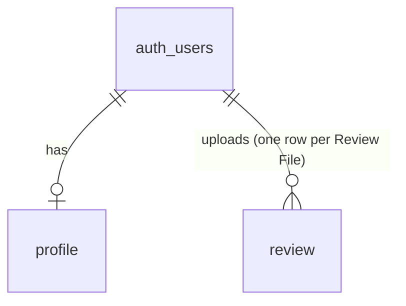

# SCHEMA: Living Letter

Promoted 2026-10-21 from `bmad-architecture` run `_bmad-output/planning-artifacts/architecture/architecture-FC-Final-Project-2026-10-21/SCHEMA-draft.md`. **Amended 2026-10-30** (AD-18, sprint change proposal 2026-10-29): the Web App runs no Reviews, so its database shrinks to two tables. No migration had been applied, so nothing is undone.

**Status: designed, not yet migrated (2026-10-30).**
- **Authority:** this file is the contract. Every migration that changes a table updates this file in the same change (RULES.md). Implementers never change it on their own (AGENTS.md).
- **First migration:** `supabase/migrations/<timestamp>_init.sql`, applied to the `dev` project first (AD-15).
- **Demo Artifact:** it has no Supabase database (AD-12). Only §3 (content shapes) and §4 (output contracts and validation rules) bind it, plus the Past Reviews store and the Review File in §6 (the Artifact platform’s `db`, not Postgres).

Terms follow the PRD Glossary. AD-n references are to `ARCHITECTURE.md`.

## 1. Entity overview

| Table | Glossary term | Written by | Mutability |
|---|---|---|---|
| `profile` | Creator Foundation (plus role) | server only (save profile) | Editable by its owner through the server |
| `review` | Review (a Saved Review) | server only (`importReviewFile`, AD-18) | Immutable (trigger); the owner may delete |
| `instagram_connection` | Connected Account | server only | Replaced on reconnect and token refresh; deleted on disconnect. **Post-MVP** (FR-16a, AD-17): not in the first migration |



**Ownership.** Every user-owned row carries `user_id uuid not null`, referencing `auth.users(id)` on delete cascade.

**Versions.** There are no version tables (AD-1, amended): the Web App imports `content/` at build. A `review` names its versions as locked ids, checked against `content/published.lock.json` at import.

## 2. Tables

### `profile`

Mirrors the Demo Artifact's `data/users/<id>/profile` (§6). The two are never synced (AD-18).

| Column | Type | Constraint |
|---|---|---|
| `user_id` | `uuid` | PK, FK `auth.users(id)` on delete cascade |
| `role` | `text` | nullable; `in ('creator','leader','individual')` |
| `come_across` | `text` | nullable; `char_length ≤ 2000`. How they want to come across (FR-15) |
| `come_across_at` | `timestamptz` | nullable; when `come_across` was last edited |
| `theology` | `text` | nullable; `char_length ≤ 2000`. Theology, tradition and convictions; recorded only, never changes scores |
| `theology_at` | `timestamptz` | nullable |
| `audiences` | `jsonb` | not null default `'[]'`; `jsonb_typeof = 'array'`. Target Audience keys in rank order. The server checks that every key exists in the latest `persona-set` in `content/` and appears at most once |
| `updated_at` | `timestamptz` | not null default `now()` |

- **Writes:** one upsert of the verified user's own row (AD-9).

### `review`

One row per uploaded Review File (FR-19, FR-26).

| Column | Type | Constraint |
|---|---|---|
| `id` | `uuid` | PK default `gen_random_uuid()` |
| `user_id` | `uuid` | not null, FK `auth.users(id)` on delete cascade |
| `rubric_version` | `text` | not null; a locked id, e.g. `witness-rubric@2` |
| `persona_version` | `text` | not null; a locked id |
| `prompt_set` | `text` | not null; a locked id |
| `review_source_url` | `text` | nullable; `~* '^https?://'`, `≤ 2048`. Display only; never fetched (AD-13) |
| `exported_at` | `timestamptz` | not null; from the file |
| `post_count` | `int` | not null; between 1 and 10 (AD-5) |
| `data` | `jsonb` | not null. The validated, redacted appendix (§6, Review File). Renders read it as text only (AD-4) |
| `imported_at` | `timestamptz` | not null default `now()` |

- **Index:** `(user_id, imported_at desc)`.
- **Trigger `forbid_update`:** rejects UPDATE. Delete is allowed.
- **Writes:** one insert by `importReviewFile` after every AD-18 check, or nothing.

### `instagram_connection` (Post-MVP: FR-16a, AD-17)

| Column | Type | Constraint |
|---|---|---|
| `user_id` | `uuid` | PK, FK `auth.users(id)` on delete cascade. One Connected Account per user |
| `ig_user_id` | `text` | not null; the Instagram professional account's id |
| `username` | `text` | not null; `char_length ≤ 30`; shown to the owner as the Connected Account |
| `token_ciphertext` | `text` | not null; the long-lived token, encrypted with `INSTAGRAM_TOKEN_KEY`. Never selected into a client response or a log |
| `expires_at` | `timestamptz` | not null; the server refreshes the token before this |
| `created_at` | `timestamptz` | not null default `now()` |
| `updated_at` | `timestamptz` | not null default `now()` |

- **Writes:** the OAuth callback upserts the row for the verified user; token refresh updates it; disconnect deletes it (AD-9).

## 3. Content file shapes (`content/`, both surfaces)

```jsonc
// content/rubric/witness-rubric@1.json
{
  "id": "witness-rubric@1", "name": "witness-rubric", "number": 1,
  "scale": { "min": 1, "max": 5, "na": true },
  "thresholds": { "lands_well_min": 3, "auto_rewrite_below": 3, "offer_rewrite_at": 3 },
  "criteria": [
    { "key": "outsider_clarity", "number": 1, "name": "Outsider Clarity",
      "scores_whether": "can be understood by someone with no church background; …",
      "guidance": { "1": "…", "3": "…", "5": "…" },
      "applies_to": "all",
      "sources": [ { "source": "Colossians 4:5–6", "principle": "…" } ] },   // verses, books and research behind the Criterion; shown to Users and sent to Assess
    { "key": "self_presentation_alignment", "number": 10, "name": "Self-Presentation Alignment",
      "scores_whether": "…", "guidance": { "…": "…" },
      "applies_to": "own_content",
      "na_reason_others": "Applies only when Creators review their own posts.",
      "sources": [ … ] }
  ],
  "offence_sources": [                   // glossary of the Offence Sources, for display; keys match AssessOutput
    { "key": "claim", "name": "Claim", "meaning": "…", "effect": "Reported, but never lowers a score." }
  ]
}

// content/personas/persona-set@1.json
{
  "id": "persona-set@1", "name": "persona-set", "number": 1,
  "personas": [                          // array order = default display order (AD-3)
    { "key": "seeker", "name": "Seeker", "summary": "…",
      "card": "markdown: background, named sub-culture, cultural touchpoints, narratives, longings, reasons for their views",
      "frame": "non_believer",           // "believer_behaviour" for emboldened_believer (FR-8)
      "grounded_in": ["…"] }             // research and sources the Persona is drawn from; shown to Users
  ],
  "target_audiences": [                  // FR-10; rule and labels approved via bmad-ux (OQ-6)
    { "key": "curious",      "label": "Reach people curious about faith",                 "lead_personas": ["seeker", "drifter"] },
    { "key": "dechurched",   "label": "Reach people who've drifted from or left church",  "lead_personas": ["drifter", "exvangelical", "progressive"] },
    { "key": "other_faiths", "label": "Reach people of other faiths or spiritualities",   "lead_personas": ["neighbor_other_faith", "seeker"] },
    { "key": "secular",      "label": "Reach skeptical or secular people",                "lead_personas": ["skeptic", "progressive"] },
    { "key": "believers",    "label": "Build up existing Christians",                     "lead_personas": ["emboldened_believer", "exvangelical", "drifter"] }
  ]
}

// content/prompts/prompts@1/manifest.json
{
  "id": "prompts@1",
  "steps": {
    "assess":          { "file": "assess.md",          "placeholders": ["guardrails", "criteria", "foundation", "post"], "required_rules": ["…"] },
    "react":           { "file": "react.md",           "placeholders": ["guardrails", "personas", "post"],              "required_rules": ["…"] },
    "discuss":         { "file": "discuss.md",         "placeholders": ["guardrails", "criteria", "personas", "post", "assessment", "reactions"], "required_rules": ["…"] },
    "rewrite":         { "file": "rewrite.md",         "placeholders": ["guardrails", "criteria", "personas", "post", "assessment", "reactions"], "required_rules": ["…"] },
    "outreach":        { "file": "outreach.md",        "placeholders": ["guardrails", "evaluations"], "required_rules": ["…"] },
    "profile_summary": { "file": "profile-summary.md", "placeholders": ["guardrails", "stats", "evaluations"], "required_rules": ["…"] }
  },
  "guardrails": { "file": "guardrails.md", "required_rules": ["…"] }
}

// content/published.lock.json
{ "witness-rubric@1": "<sha256>", "persona-set@1": "<sha256>", "prompts@1": "<sha256>" }
```

## 4. Model-output contracts (both surfaces; AD-4)

### 4.1 `AssessOutput`
```jsonc
{
  "post_transcript": "string",          // the Post's own caption + on-screen text only (AD-5)
  "scores": [
    { "criterion": "outsider_clarity",
      "score": 4,                        // integer 1–5, or null for N/A
      "evidence": "string | null",       // quote, or a description of a screenshot region
      "explanation": "string",           // 2–3 plain sentences (FR-4); for N/A, why it does not apply
      "offence_sources": ["tone"] }      // subset of ["claim", "tone", "jargon"]
  ],
  "soundness_flag": null                 // or { "line": "string", "why": "string" }
}
```

### 4.2 `ReactOutput`
```jsonc
{ "reactions": [ { "persona": "seeker", "felt_response": "confused",
                   "valence": "positive | negative | mixed",
                   "reasons": ["string"] } ] }
```

### 4.3 `DiscussOutput`
```jsonc
{ "questions": [ { "text": "string",
                   "standing": "done_differently | bible_says | jesus_responded | jesus_posted | null",
                   "persona": "persona key | null" } ] }   // persona set when the question cites a Persona (simulated label, AD-14)
```

### 4.4 `RewriteOutput`
```jsonc
{ "rewrite": "string", "changes": ["string"] }
```

### 4.5 `OutreachOutput`
```jsonc
{ "outreach_message": "string",
  "talking_points": [ { "post_position": 1, "criterion": "outsider_clarity",
                        "kind": "affirmation | concern", "text": "string",
                        "change": "string | null", "persona": "persona key | null" } ] }
```

### 4.6 Profile Summary
- **`stats`** (code-computed, AD-3):
  - `post_ids`
  - `post_count`
  - `criterion_averages {key: number|null}`
  - `posts_with_offence_source {claim, tone, jargon}`
  - `posts_below_3 {key: count}`
  - `persona_valence {persona: {positive, negative, mixed}}`
  - `strongest_post` and `weakest_post` (positions)
- **`narrative`** (model): `{ "patterns": ["string"], "top_changes": ["string"] }`. **After the MVP** (AD-3, amended 2026-10-30): no surface calls it.

### 4.7 Validation rules (bind both validators; AD-4, AD-16)

| Rule | Applies to |
|---|---|
| Objects are strict. Unknown keys reject (`z.strictObject`; the hand validator does the same) | every contract |
| `scores` covers exactly the pinned rubric's Criterion keys, in rubric order, with no duplicates | Assess |
| `score` is an integer 1–5, or null | Assess |
| `evidence` is a non-empty string if and only if `score` is not null | Assess |
| `offence_sources` is empty when `score` is null and non-empty when `score ≤ 3`. It may be non-empty at 4–5, so claim offence is still reported. A `score < 3` must include `tone` or `jargon`: claim alone never lowers a score (FR-4) | Assess |
| `explanation` is a non-empty string | Assess |
| `reactions` covers exactly the Persona keys, in any order, with no duplicates. `reasons` holds 1–3 non-empty strings | React |
| `questions` holds 4–6 items. Each `standing` key appears exactly once; the rest are null. `persona` is a Persona key or null | Discuss |
| `rewrite` is non-empty. `changes` holds 1–5 strings | Rewrite |
| `talking_points` holds 3–5 items. `post_position` is a done Post of this Review. `criterion` is a rubric key. `change` is required when `kind = concern`. At most 3 `concern` items | Outreach |
| `patterns` holds 1–5 strings and `top_changes` holds 2–3 | Profile Summary |
| **Artifact extraction:** take the JSON substring from the first `{` to the last `}`. Nothing else is stripped | Artifact |
| **After validation:** run the overrides (AD-3), then `redactHandles` over every string (AD-5), then derive | both surfaces |

**Additive contracts.** New fields go at the end and are optional. No field is renamed, retyped or removed. A breaking change ships with a new `prompts@n` (AD-4).

### 4.8 Evaluation (stored, and in a Review File)

The object `artifact/src/pipeline.js` builds per Post, saved in Past Reviews and in a Review File (AD-18). Strict keys:
- `post_transcript`: string, lifted out of the Assess output;
- `assessment`: `{scores, soundness_flag}`, which is §4.1 without `post_transcript`, after the AD-3 overrides and `redactHandles`;
- `reactions`: §4.2;
- `discussion_questions`: §4.3, or null;
- `gentler_rewrite`: §4.4, or null;
- `lands_well`: boolean, and `rewrite_mode`: `auto` | `offer` | `none` | `not_assessable` (AD-3);
- `models`: `{assess, react, discuss?, rewrite?}`, the answering model ids (AD-6).

## 5. Access control (RLS)

Every table has RLS enabled, with its policies in the same migration. Own means `user_id = (select auth.uid())`:
- in `using` for select, update and delete;
- in `with check` for insert and update.

The secret key, used by server code only, bypasses RLS. Writes are server-only (AD-9).

| Table | `anon` | `authenticated` |
|---|---|---|
| `profile`, `review` | none | select own |
| `instagram_connection` (Post-MVP) | restrictive deny-all policy, plus `revoke all` | restrictive deny-all policy, plus `revoke all`. The owner sees their Connected Account's `username` only through a server response |

Users never insert, update or delete through the Data API. Review deletion is a Server Action that deletes with `user_id = <verified uid>` (AD-9).

## 6. Off-store state

- **`content/`** is the source of truth for every version. `content/published.lock.json` locks published ids (AD-1). `conformance/` holds the shared test vectors (AD-16). `config/models.json` holds the only model ids and prices (AD-7).
- **Supabase projects:** two free projects (AD-15).
  - `dev`: development, agents and tests.
  - `prod`: Vercel Production only.

  Neither has Storage buckets. The Free plan has no automatic backups, and Bennett takes a `supabase db dump` before a demo.
- **Vercel Production environment only:**
  - `SUPABASE_SECRET_KEY` (`sb_secret_…`);
  - Post-MVP (AD-17): `INSTAGRAM_APP_ID`, `INSTAGRAM_APP_SECRET` and `INSTAGRAM_TOKEN_KEY`.

  Public on every environment: `NEXT_PUBLIC_SUPABASE_URL`, `NEXT_PUBLIC_SUPABASE_PUBLISHABLE_KEY` (`sb_publishable_…`) and `NEXT_PUBLIC_ARTIFACT_URL`. Preview has no secrets. No environment holds an Anthropic key (AD-18).
- **Local `.env.local`:** dev-project keys only. Post-MVP: the Instagram app's Development-mode credentials (AD-17).
- **Constants in code:** `MAX_REVIEW_FILE_BYTES = 2_000_000`, `MAX_POSTS_PER_REVIEW = 10` (AD-5, AD-18).
- **Supabase Auth (both projects):** email provider on; "Allow new users to sign up" on; "Confirm email" on; custom SMTP set in Auth settings (credentials only there); site URL and redirect URLs per project (AD-11). New projects use asymmetric JWT signing keys, so `getClaims()` verifies locally.
- **Screenshots:** they exist only in the Artifact page's memory. A Review File carries only `screenshot_count`; nothing stores or renders them (AD-5).
- **Review File (cross-surface contract, AD-12, AD-18):** the `.md` file the Artifact saves through Save Review as file. Its last fenced `json` block after `## Raw data (JSON)` is written by `reviewToMarkdown` in `artifact/src/export.js` and holds, strictly (no other keys):
  - `exported_at` (ISO 8601);
  - `versions`: `{rubric, personas, prompts}`, each a locked id;
  - `review_source_url`: string or null;
  - `posts`: 1–10 of `{position, status, source_url, pasted_text, video_transcript, screenshot_count, evaluation}`. `status` ∈ `pending`, `evaluating`, `done`, `failed`, `refused`. When `done`, `evaluation` passes §4.8 for the pinned versions. Otherwise the file may hold a partial evaluation (`export.js` writes `evaluation || null`); the importer stores `null` instead (AD-18);
  - `outreach`: null, or `{status: 'done', model: string, output}` where `output` passes §4.5 (the Artifact's `state.outreach` as written by `ui.js`).

  A change is additive only, and the Web App validator and the Review File vectors change in the same commit (AD-16). `artifact/sample-review.json` uses the same shape.
- **Demo Artifact:**
  - Reviews live in page memory while the page is open. Each sent Review is also saved to Past Reviews (2026-10-26, Bennett) in the viewer’s private `db` subtree, which nobody else can read, the Artifact’s owner included (`artifact/src/past.js`):
    - `data/users/<viewer id>/<review id>`: `savedAt`, `reviewSourceUrl`, `modelId`, `labels` (the three content ids), `postCount`, `tally`, and the finished `outreach` or null.
    - `data/users/<viewer id>/<review id>/posts/<position>`: `position`, `pasted_text`, `video_transcript`, `source_url`, `image_names`, `status`, `evaluation` (only when `done`) and `error`. Screenshots are never stored, only their file names (AD-5).
    - A Review whose `labels` differ from the page’s versions is listed but cannot be reopened (FR-20). Delete removes the Review and its Posts.
    - `data/users/<viewer id>/profile` (2026-10-28, `artifact/src/profile.js`): `role` (`creator` | `leader` | `individual` | `""`), `come_across` and `theology` (free text, up to 2,000 characters each) with `come_across_at` and `theology_at` (when each was last edited, or `""`), `audiences` (Target Audience keys from the Persona set, in the viewer's order) and `updatedAt`. It sits in the same collection as the Reviews and is skipped when they are listed. Each Review record also keeps `foundation`, a copy of the role and preferences when it was saved, or null.
  - `artifact/sample-review.json` (optional, FR-24) is a build input, not stored state: the JSON appendix of a saved Review (`export.js` shape: `exported_at`, `versions`, `review_source_url: null`, one or more done `posts` with `source_url` null or an Instagram post link, `screenshot_count` 0 and no @handle, and `outreach` null or done). The build checks it and inlines it. The guided demo replays it on Send, and the resulting Review is saved to Past Reviews in the shapes above like any sent Review (Post `source_url` = the reel link, `foundation` as usual); nothing marks it as a sample in the store.
  - No browser storage is used.
  - The platform's `sample` answer cache lasts 5 minutes per viewer and browser. It is bypassed with `cache: false` on Try again.

## 7. Migrations

- **Location:** `supabase/migrations/`, written with `supabase migration new` and applied with `supabase db push`, to `dev` by default.
- **Pushing to prod:** Bennett pushes to `prod`, or an agent does with his OK in chat, before the code that needs the migration reaches `main` (AD-15).
- **First migration:** creates every table, check, index, trigger and function above, and every RLS policy and grant, in the same file.
- **Content is not a migration.** The Web App imports `content/` at build (AD-1).
- **Append-only:** once applied, a migration is never edited. To change it, write a new one.

## Keeping this true

This file is the contract (RULES.md; AGENTS.md: implementers never change it on their own).
- Columns and output-contract fields are fixed. New ones are added at the end, in the same change as the migration that adds them.
- If a migration and this file disagree, stop and ask Bennett. Do not regenerate either side to match the other.
