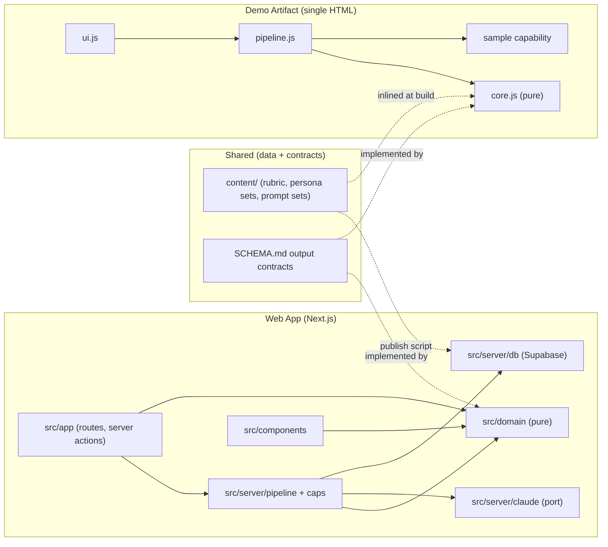
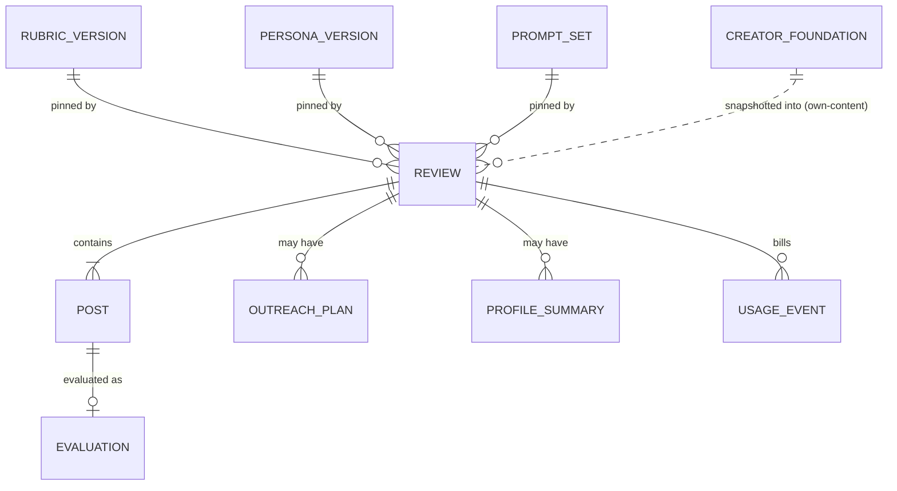

# Architecture Spine — Witness Review

## Design Paradigm

**Functional core, imperative shell.** The judgement lives in versioned data (`content/`) and in the output contracts (`SCHEMA.md` §Evaluation contracts). The arithmetic lives in pure functions. Each surface is a thin shell that does I/O: it calls Claude, validates the result, persists it (Web App only), and renders it. The two surfaces share **data and contracts, never code**.

| Layer | Demo Artifact | Web App | May depend on |
|---|---|---|---|
| Content (versioned data) | inlined from `content/` at build | `content/` → version tables via publish script | nothing |
| Core (pure) | `artifact/src/core.js` | `src/domain/` | content shapes only |
| Shell: model access | `sample` capability | `src/server/claude/` (port + live/fake adapters) | core |
| Shell: persistence | none (page memory) | `src/server/db/` (Supabase) | core |
| Shell: orchestration | `artifact/src/pipeline.js` | `src/server/pipeline/`, `src/server/caps/` | core, model access, persistence |
| UI | `artifact/src/ui.js` | `src/app/`, `src/components/` | core (types, pure helpers); `src/app` also calls orchestration |



## Invariants & Rules

### AD-1 — Content is immutable, versioned data with one source [ADOPTED]

- **Binds:** FR-7, FR-20, FR-21, both surfaces
- **Prevents:** the Artifact and the Web App carrying different rubric or persona text, and a published version silently changing under saved Evaluations.
- **Rule:**
  - Rubric Versions, Persona Versions and prompt sets exist only as files in `content/`, named `<name>@<n>`:
    - `content/rubric/witness-rubric@1.json`
    - `content/personas/persona-set@1.json`
    - `content/prompts/prompts@1/*.md`
  - A change is a new file with the next `<n>`. A published file is never edited.
  - The Demo Artifact inlines the files at build.
  - The Web App reads versions only from the `rubric_version`, `persona_version` and `prompt_set` tables, which are filled by `npm run publish:content`. That script:
    - inserts new ids;
    - skips ids that already exist with the same SHA-256;
    - fails on an existing id whose hash differs.
  - A database trigger rejects every UPDATE and DELETE on the three version tables.
  - "Latest" means the highest `<n>` for that name.

### AD-2 — Two-step Evaluation pipeline; step 1 is blind [ADOPTED]

- **Binds:** FR-4, FR-6, FR-8, FR-11, FR-12, both surfaces
- **Prevents:** Persona Reactions feeding Rubric Scores (PRD §4.3), and each surface inventing its own call graph.
- **Rule:** Each Post is evaluated with up to four model calls:
  - **Step 1, in parallel:**
    - **Assess** returns the Rubric Scores (with Evidence, reason and Offence Source), the Soundness Flag and `post_transcript`.
    - **React** returns one Persona Reaction per Persona in the Persona Version.
    - Neither call receives the other's output.
  - **Step 2, in parallel, after step 1:**
    - **Discuss** receives both step-1 outputs. It returns 4–6 Discussion Questions, including the four standing ones; questions may reference reactions and name any score/reaction mismatch.
    - **Rewrite** runs only when AD-3 says so. It receives both step-1 outputs.
  - **Images in step 2:** step-2 calls receive `post_transcript` and the pasted text, never the images. Images go only to Assess and React.
  - The on-demand "Suggest a gentler version" action reuses the Rewrite call unchanged.
  - Review-level calls (**Outreach** for FR-13, **Profile Summary** for FR-14) take validated Evaluations as input, never raw model text.

### AD-3 — Arithmetic is code, judgement is model [ADOPTED]

- **Binds:** FR-4, FR-5, FR-11, FR-14, both surfaces
- **Prevents:** thresholds and roll-ups drifting with model mood, and the two surfaces disagreeing on whether a Post "lands well".
- **Rule:** These are computed in code from validated scores, never asked of the model:
  - **Lands well:** no non-N/A score is below 3.
  - **Auto-Rewrite:** any score is below 3.
  - **"Suggest a gentler version" offered:** the Post lands well and its minimum score is 3.
  - **No rewrite:** all scores are 4 or above.
  - **Criterion 10:** forced to N/A on every Others' Review, whatever the model returned.
  - **Profile Summary arithmetic:** Criterion averages, Offence Source counts, Persona valence tallies, and strongest and weakest Post.

  The model writes only prose judgement: Evidence, reasons, reactions, questions, rewrite, outreach, and the pattern narrative.

### AD-4 — Every model output is validated at the shell boundary and rendered as text

- **Binds:** both surfaces
- **Prevents:** malformed or partial model output reaching the screen or the database, and markup in Posts or outputs executing as HTML.
- **Rule:**
  - Each call's output is parsed and checked against its contract in `SCHEMA.md` (Zod schemas in `src/domain/contracts.ts`; an equivalent hand-checked validator in `artifact/src/core.js`).
  - Output that fails validation is shown as a per-Post error with a manual "Try again". It is never rendered or persisted in part.
  - Model output and Post text are rendered as text nodes only, never as HTML.
  - No surface retries automatically.

### AD-5 — Untrusted input and third-party privacy (resolves OQ-5 screenshots) [ADOPTED]

- **Binds:** FR-1, FR-19, PRD §7.2, §7.5, both surfaces
- **Prevents:**
  - injected Post text changing the Rubric, Personas or output format;
  - commenters' names or handles being stored or displayed.
- **Rule:**
  - **Prompts:** Post text, transcripts and screenshot instructions sit inside `<post>…</post>` delimiters after all instructions, and the prompt declares delimited content to be data.
  - **Assess:** transcribes only the Post's own caption and on-screen text into `post_transcript`. It never transcribes comment sections or any name or handle other than the poster's.
  - **Contracts:** no output contract has a field for third-party names.
  - **Screenshots are transient on both surfaces.** In the Web App they travel in the evaluate request body and are discarded after the step-1 calls. They are never written to Postgres, Supabase Storage, Vercel Blob or logs; a Post keeps only `image_count`.
  - **Image downscaling:** the browser downscales each screenshot to at most 1568 px on the long edge as JPEG before upload, keeping each request under Vercel's 4.5 MB body limit.

### AD-6 — Provenance travels with every Evaluation [ADOPTED]

- **Binds:** FR-7, FR-15, FR-19, FR-21, both surfaces
- **Prevents:** saved Evaluations whose versions are unknown, mixed versions inside one Review, and cross-version score comparisons.
- **Rule:**
  - **Pinned at creation:** a Review pins `rubric_version_id`, `persona_version_id` and `prompt_set_id` (latest of each) when it is created. Every Evaluation in it carries the same three ids, enforced by a composite foreign key to the Review.
  - **Model:** each Evaluation records the `model_id` that answered its Assess call.
  - **Creator Foundation:** an Own-Content Review stores `foundation_snapshot` at creation, so later edits to the Creator Foundation never change it.
  - **Display:** every Evaluation shows the label `witness-rubric@n · persona-set@n · prompts@n · <model id>`.
  - **Comparisons** of scores happen only within one Rubric Version.

### AD-7 — Claude access boundary and model constant

- **Binds:** both surfaces, RULES.md stack rules
- **Prevents:** the API key or SDK leaking into client bundles, model IDs scattered across files, and real API spend during development.
- **Rule:**
  - **Web App:**
    - Claude is called only from `src/server/claude/`, through one `ClaudePort` with a `live` adapter (`@anthropic-ai/sdk`) and a `fake` adapter (canned fixtures, the default in development and tests).
    - Every module under `src/server/` imports `server-only`.
    - ESLint `no-restricted-imports` forbids `@anthropic-ai/sdk` outside `src/server/claude/`.
    - The model id lives in one constant: `CLAUDE_MODEL = "claude-opus-5-5"` (`src/server/claude/model.ts`), with `CLAUDE_EFFORT = "medium"` set explicitly and the per-MTok prices it bills at beside it.
    - Calls use structured outputs (`output_config.format`) and server-side refusal fallback (`fallbacks: "default"`). A `refusal` stop reason becomes the Post status `refused`.
  - **Demo Artifact:**
    - Claude is called only through `sample()` (not `sample.json`, so `modelApplied` is available).
    - The model defaults to `claude-opus-5-5` with `modelTier: "complex"` as the fallback.
    - The viewer may switch to Sonnet 5.5 (`default`) or Haiku 5.5 (`quick`).
    - The answering model is shown in the provenance label.

### AD-8 — Spend control: off-switch, caps, ledger, backstop (resolves FR-23) [ADOPTED]

- **Binds:** FR-18, FR-23, Web App
- **Prevents:** any Web App Review running without Bennett's permission, and API spend beyond the agreed caps.
- **Rule:**
  - **Off-switch and monthly cap.** Before every Claude call, on either adapter, `src/server/caps/` checks, in this order:
    1. `REVIEWS_ENABLED === "true"`. It is unset (false) in production until Bennett sets it in Vercel. If it is off, the server answers `reviews_paused`.
    2. Month-to-date spend is under `MONTHLY_SPEND_CAP_USD = 25`. Month-to-date spend is `sum(usage_event.cost_usd)` since 00:00 UTC on the 1st. If it is reached, the server answers `monthly_cap_reached`.
  - **At Review creation**, the server checks:
    - the account has fewer than `DAILY_REVIEW_CAP = 3` `review_created` rows in `usage_event` in the rolling 24 hours, or it answers `daily_cap_reached` with `retry_at` = the oldest such row + 24 h;
    - the Review has `MAX_POSTS_PER_REVIEW = 10` Posts or fewer.

    It then appends a `review_created` row. `usage_event` is an append-only ledger with no foreign keys, so deleting Reviews never resets either cap.
  - **After every Claude call**, the server appends one `usage_event` row with tokens and `cost_usd` (0 on the fake adapter).
  - **Backstop:** the Web App's API key belongs to a dedicated Anthropic workspace with a $30 monthly spend limit.
  - **Agent rule:** coding agents never set `CLAUDE_ADAPTER=live` locally, and never make a live Claude call from the Web App, without Bennett's explicit OK in chat.

### AD-9 — Data access posture: users read their own rows; only the server writes

- **Binds:** FR-18, FR-19, SCHEMA.md RLS, Web App
- **Prevents:** a client bypassing caps or forging model output through Supabase's REST API, and two code paths writing the same entity.
- **Rule:**
  - **Browser:** uses Supabase only for the auth session (`@supabase/ssr` cookies) and never queries tables directly.
  - **Reads:** run in server code through the user-scoped client, under RLS policies that let a user `select` only rows where `user_id = auth.uid()`.
  - **Writes:** every write to `review`, `post`, `evaluation`, `outreach_plan`, `profile_summary` and `usage_event` goes through `src/server/db/` with the secret-key client, after the session user is verified and the AD-8 checks pass. The one exception is `creator_foundation`, which a user may insert and update under RLS for their own row.
  - **Deletes:** a user may delete their own Reviews, which cascades to Posts, Evaluations and outputs.
  - **`usage_event`:** has RLS enabled and no policies.
  - **Version tables:** `select` for authenticated users only.

### AD-10 — The Post is the unit of work and of failure

- **Binds:** FR-1, NFR latency, both surfaces
- **Prevents:** one failing Post sinking a Review, a 10-Post Review blowing request limits, and the surfaces queueing differently.
- **Rule:**
  - **Orchestration:** the browser orchestrates one evaluate request per Post. The Web App keeps at most 2 Posts in flight; the Artifact keeps 1, since `sample` already queues beyond a couple of calls.
  - **Web App persistence:** an Evaluation is inserted only when Assess, React and Discuss have all validated, plus Rewrite when AD-3 requires it.
  - **Post status:** moves `pending → evaluating → done | failed | refused`. A failed Post does not fail its Review.
  - **Rendering:** Evaluations render as each Post completes.

### AD-11 — Sign-in is invite-only [ADOPTED]

- **Binds:** FR-18, Web App
- **Prevents:** strangers creating accounts on an unshared but public URL.
- **Rule:**
  - Supabase Auth uses email + password, with public sign-up disabled.
  - Bennett creates each account in the Supabase dashboard (auto-confirmed, no email sent).
  - Running a Review requires a session.
  - No account exists for minors.

### AD-12 — The Demo Artifact is one self-contained page that keeps nothing [ADOPTED]

- **Binds:** FR-1, FR-2, FR-17, FR-22, PRD §7.2, Demo Artifact
- **Prevents:** keys, network calls, persisted third-party content, or preloaded real posts in the published Artifact.
- **Rule:**
  - `artifact/build.mjs` inlines `content/` and `artifact/src/` into a single `artifact/dist/witness-review.html`, which is published with the Artifact tool.
  - **Capabilities:** exactly `{sample: {images: true}}`.
  - **Storage:** Reviews live in page memory only; there is no `db`, no `artifact` self-publish and no browser storage of Reviews.
  - **Network:** no fetch of any URL. A Source URL is displayed and never fetched.
  - **Built-in examples:** any built-in example Post is fictional.
  - **Costs and limits:** calls run on the viewer's own Claude usage, behind the platform's consent prompt and rate limits, and are made only from an explicit viewer action.

### AD-13 — FR-3 is dropped [ADOPTED]

- **Binds:** FR-2, FR-3
- **Prevents:** any code path that reads a Post from a URL.
- **Rule:**
  - No Permitted Retrieval route exists in MVP. TikTok oEmbed was tested on 2026-10-21 and returns no caption.
  - No surface fetches a Source URL.

## Consistency Conventions

| Concern | Convention |
| --- | --- |
| Domain naming | PRD Glossary terms verbatim: Review, Post, Evaluation, Rubric Version, Persona Version, Persona Reaction, Felt Response, Offence Source, Gentler Rewrite, Soundness Flag, Discussion Questions, Ministry Outreach Plan, Talking Point, Profile Summary, Creator Foundation, Target Audience. DB tables are snake_case singular (`rubric_version`); TS types are PascalCase (`RubricVersion`). Never "verdict"; never "artifact" for model output |
| Content keys | Criterion keys and Persona keys are kebab-case slugs fixed by their version file (`outsider-clarity`, `kingdom-over-party`, `neighbor-of-another-faith`, `emboldened-believer`). Version ids are `<name>@<n>` |
| IDs, time, money | Row ids are `uuid` (`gen_random_uuid()`). Times are `timestamptz` UTC, with ISO 8601 in JSON. Money is `numeric(10,6)` USD, computed from token usage × the prices beside `CLAUDE_MODEL` |
| Server error shape | `{ "error": { "code": string, "message": string, "retry_at"?: string } }`. Codes: `reviews_paused`, `monthly_cap_reached`, `daily_cap_reached`, `too_many_posts`, `invalid_model_output`, `refused`, `upstream_error`, `unauthenticated` |
| Prompt assembly | Instructions first, then versioned content, then `<post>…</post>` data. The static prefix (rubric or persona set + instructions) is byte-stable so it caches. Prompt text lives in `content/prompts/`, never in TS or JS strings |
| Logging | Ids, step, token counts, error codes only. Never Post text, transcripts, images or model prose |
| Config (Web App env) | `ANTHROPIC_API_KEY`, `SUPABASE_SECRET_KEY` (server only); `NEXT_PUBLIC_SUPABASE_URL`, `NEXT_PUBLIC_SUPABASE_PUBLISHABLE_KEY`; `REVIEWS_ENABLED` (default `false`); `CLAUDE_ADAPTER` (`fake` or `live`; default `fake`, and production sets `live`) |
| Simulated label | Every Persona Reaction renders with a visible "Simulated perspective" label (FR-9) |
| Check command | `npm run lint && npm run typecheck && npm run test && npm run build`. `test` runs Vitest on `src/domain/` and `src/server/caps/` with the fake adapter [ASSUMPTION] |

## Stack

| Name | Version |
| --- | --- |
| Node.js (Vercel functions) | 24.x |
| Next.js (App Router, Turbopack, `src/` dir) | 16.4.2 |
| React | 19.3.1 |
| TypeScript (strict) | 5.9.3 |
| ESLint + eslint-config-next | 9.39.5 + 16.4.2 |
| Tailwind CSS (create-next-app default; tokens owned by DESIGN.md) | 4.3.3 |
| @anthropic-ai/sdk | 0.137.0 |
| @supabase/supabase-js | 2.118.0 |
| @supabase/ssr | 0.12.7 |
| Supabase CLI (migrations) | 2.121.0 |
| zod | 4.6.7 |
| vitest | 5.0.5 |
| server-only | 0.0.1 |
| Claude model (both surfaces) | claude-opus-5-5 |
| Artifact runtime contract (`sample`) | 0.2.88 |
| Hosting | Vercel Hobby; Supabase Free (one project) |

## Structural Seed

```mermaid
flowchart TB
  subgraph viewer["Viewer's claude.ai"]
    DA["Demo Artifact page"] -->|sample(), viewer-paid| CLA["Claude (viewer plan)"]
  end
  subgraph vercel["Vercel (production from main)"]
    NX["Next.js app: server components, server actions, route handlers"]
  end
  BR["Browser (signed-in user)"] -->|HTTPS, per-Post evaluate| NX
  BR -->|auth session cookies| SA["Supabase Auth"]
  NX -->|user-scoped reads, RLS| PG[("Supabase Postgres")]
  NX -->|secret-key writes| PG
  NX -->|live adapter, REVIEWS_ENABLED| API["Claude API (dedicated workspace, $30 limit)"]
  REPO["GitHub repo: content/, supabase/migrations"] -->|git push main| vercel
  REPO -->|supabase db push; npm run publish:content| PG
```



```text
FC-Final-Project/
  content/                 # AD-1: versioned data, one source for both surfaces
    rubric/                #   witness-rubric@1.json
    personas/              #   persona-set@1.json (includes FR-10 audience order, OQ-6)
    prompts/prompts@1/     #   assess.md react.md discuss.md rewrite.md outreach.md profile-summary.md
  artifact/                # AD-12: Demo Artifact
    src/                   #   core.js (pure), pipeline.js (sample), ui.js
    build.mjs              #   inlines content/ + src/ → dist/witness-review.html
  src/                     # Web App (Next.js 16, App Router)
    app/                   #   routes, server actions, route handlers (thin)
    components/            #   UI; never imports src/server or the SDK
    domain/                #   pure: contracts.ts (Zod), thresholds, summary math, prompt assembly, cost math
    server/                #   'server-only': claude/ (port, live, fake, model.ts), db/, caps/, pipeline/
  scripts/publish-content.ts  # AD-1: content/ → version tables (hash-checked)
  supabase/migrations/     # SCHEMA.md; append-only once applied
```

## Capability → Architecture Map

| Capability / Area | Lives in | Governed by |
| --- | --- | --- |
| FR-1 Paste + screenshots | `artifact/src/ui.js`; `src/components` intake + browser downscale | AD-5, AD-10 |
| FR-2 Source URL (display only) | Post/Review fields | AD-12, AD-13 |
| FR-3 TikTok pre-fill | — (dropped) | AD-13 |
| FR-4/5/6 Scores, lands-well, Soundness Flag | Assess call + `domain` thresholds | AD-2, AD-3, AD-4 |
| FR-7 / FR-20 / FR-21 Versions | `content/`, version tables, publish script | AD-1, AD-6 |
| FR-8/9 Persona Reactions, simulated label | React call + UI | AD-2, conventions |
| FR-10 Persona order by Target Audience | `persona-set@n.json` audience order + UI sort (display only) | AD-1, OQ-6 |
| FR-11 Gentler Rewrite | Rewrite call | AD-2, AD-3 |
| FR-12 Discussion Questions | Discuss call | AD-2 |
| FR-13 Ministry Outreach Plan | Outreach call; `outreach_plan` table | AD-2, AD-9 |
| FR-14 Profile Summary | `domain` summary math + Profile Summary call | AD-3 |
| FR-15/16 Creator Foundation, Own-Content, Draft Checkpoint, Criterion 10 | `creator_foundation`; `review.kind`, `post.is_unpublished` | AD-3, AD-6, AD-9 |
| FR-17 "Lands anywhere" reminder | static UI, both surfaces | — |
| FR-18 Accounts | Supabase Auth | AD-9, AD-11 |
| FR-19 Saved Reviews | `review` + children, reopened read-only | AD-5, AD-6, AD-9 |
| FR-22 Roadmap tab | static Artifact tab | AD-12 |
| FR-23 Caps | `src/server/caps/`, `usage_event` | AD-8 |
| OQ-5 | screenshots (AD-5), caps (AD-8), Artifact calls (AD-12) | — |

## Deferred

- **Persona order rule for FR-10:** owned by `bmad-ux` (OQ-6). Architecture fixes only where it lives: inside the Persona Version file.
- **Within-Post progressive streaming** (scores before reactions): AD-10 renders per Post. Revisit if a single-Post Evaluation on Opus 5.5 exceeds the 60 s NFR in Thursday's Artifact runs; the first lever is lower step-2 effort.
- **Effort tuning per step:** one explicit `CLAUDE_EFFORT` for now. Tune once real `usage_event` data exists.
- **Atomic cap reservation:** the check-then-insert can overshoot by in-flight calls (a few dollars at most). The workspace limit is the hard stop. Revisit only if the link is shared widely.
- **Stored screenshots** (user crop, or auto-redaction): rejected for MVP by AD-5. Revisit only with a guarantee for §7.2.
- **Google OAuth / magic-link sign-in, custom SMTP:** not needed while sign-in is invite-only.
- **Staging environment, backups beyond Supabase Free defaults, observability beyond Vercel logs:** not needed for an unshared demo.
- **Batch API (50% off):** latency-incompatible with interactive Reviews.
- **OQ-1 prevalence weighting, OQ-2 soundness standard:** product questions, owned by Bennett.
- **Artifact UI framework and visual system:** decided at build by `artifact-design`, with `DESIGN.md`.
