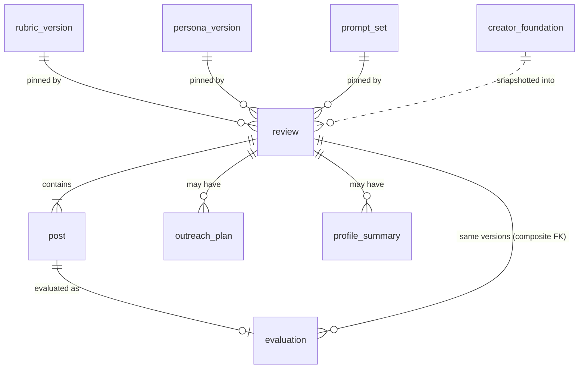

# SCHEMA: Witness Review

**Status: designed, not yet migrated (2026-10-21).** This is the contract for the first migration, `supabase/migrations/<timestamp>_init.sql`. Once that migration exists, the migrations are right and this file follows them.

The Friday Demo Artifact has no database: it keeps everything in page memory (`ARCHITECTURE.md` AD-12). Only the model-output contracts (§4) and the content file shapes (§3) bind the Artifact.

Terms follow the PRD Glossary. Decisions cited as AD-n are in `ARCHITECTURE.md`.

## 1. Entity overview

| Table | Glossary term | Written by | Mutability |
|---|---|---|---|
| `rubric_version` | Rubric Version | `npm run publish:content` | Immutable (trigger) |
| `persona_version` | Persona Version | `npm run publish:content` | Immutable (trigger) |
| `prompt_set` | (prompt set, provenance only) | `npm run publish:content` | Immutable (trigger) |
| `creator_foundation` | Creator Foundation | the User (own row, under RLS) | Editable; snapshotted into each Own-Content Review |
| `review` | Review | server only | Immutable after insert; the owner may delete |
| `post` | Post | server only | Only `status` and `post_transcript` change |
| `evaluation` | Evaluation | server only | Immutable except `gentler_rewrite`, which is set once (trigger) |
| `outreach_plan` | Ministry Outreach Plan | server only | Immutable; regenerating adds a row |
| `profile_summary` | Profile Summary | server only | Immutable; regenerating adds a row |
| `usage_event` | (spend ledger) | server only | Append-only (trigger); no foreign keys |



Every user-owned table has `user_id uuid not null references auth.users(id) on delete cascade`. `usage_event` has no foreign keys.

## 2. Tables

### Version tables: `rubric_version`, `persona_version`, `prompt_set`

All three share one shape.

| Column | Type | Constraint |
|---|---|---|
| `id` | `text` | PK; equals `name || '@' || number` (check) |
| `name` | `text` | not null (`witness-rubric`, `persona-set`, `prompts`) |
| `number` | `int` | not null, `> 0`; `unique (name, number)` |
| `content` | `jsonb` | not null; the file shape in §3 |
| `content_sha256` | `text` | not null; hex SHA-256 of the canonical file bytes |
| `published_at` | `timestamptz` | not null default `now()` |

- **Immutability:** the trigger `forbid_version_change` raises on `BEFORE UPDATE OR DELETE` (row level) and `BEFORE TRUNCATE` (statement level).
- **Publishing:** `publish:content` inserts new ids, skips an existing id whose hash matches, and fails on an existing id whose hash differs (AD-1).

### `creator_foundation`

| Column | Type | Constraint |
|---|---|---|
| `user_id` | `uuid` | PK, FK `auth.users` on delete cascade |
| `self_presentation` | `text` | not null; how the Creator wants to come across |
| `target_audiences` | `jsonb` | not null; ordered array of Target Audience keys from the current Persona Version (rank = index) |
| `updated_at` | `timestamptz` | not null default `now()` |

### `review`

| Column | Type | Constraint |
|---|---|---|
| `id` | `uuid` | PK default `gen_random_uuid()` |
| `user_id` | `uuid` | not null, FK |
| `kind` | `text` | not null, `in ('others','own')` |
| `is_draft_checkpoint` | `boolean` | not null default `false`; check `not is_draft_checkpoint or kind = 'own'` |
| `title` | `text` | nullable |
| `source_url` | `text` | nullable; the Profile URL (FR-2), never fetched |
| `rubric_version_id` | `text` | not null, FK `rubric_version` |
| `persona_version_id` | `text` | not null, FK `persona_version` |
| `prompt_set_id` | `text` | not null, FK `prompt_set` |
| `model_id` | `text` | not null; `CLAUDE_MODEL` at creation |
| `foundation_snapshot` | `jsonb` | check `(kind = 'own') = (foundation_snapshot is not null)` |
| `created_at` | `timestamptz` | not null default `now()` |

- **Composite key:** `unique (id, rubric_version_id, persona_version_id, prompt_set_id)` is the target of `evaluation`'s composite FK (AD-6).
- **Index:** `(user_id, created_at desc)`.

### `post`

| Column | Type | Constraint |
|---|---|---|
| `id` | `uuid` | PK |
| `review_id` | `uuid` | not null, FK `review` on delete cascade |
| `user_id` | `uuid` | not null, FK |
| `position` | `smallint` | not null, `between 1 and 10`; `unique (review_id, position)` |
| `source_url` | `text` | nullable; never fetched |
| `pasted_text` | `text` | nullable; caption or on-screen text the User pasted |
| `video_transcript` | `text` | nullable; pasted by the User |
| `is_unpublished` | `boolean` | not null default `false`; true for a Draft Checkpoint Post |
| `image_count` | `smallint` | not null default `0`, `between 0 and 4` [ASSUMPTION: 4 screenshots per Post] |
| `post_transcript` | `text` | nullable; written from Assess output (AD-5) |
| `status` | `text` | not null default `'pending'`, `in ('pending','evaluating','done','failed','refused')` |
| `created_at` | `timestamptz` | not null default `now()` |

- **Content check:** `pasted_text is not null or video_transcript is not null or image_count > 0`.
- **No image column exists by design.** Screenshots are never stored (AD-5).

### `evaluation`

| Column | Type | Constraint |
|---|---|---|
| `id` | `uuid` | PK |
| `post_id` | `uuid` | not null, unique, FK `post` on delete cascade |
| `review_id` | `uuid` | not null |
| `user_id` | `uuid` | not null, FK |
| `rubric_version_id` / `persona_version_id` / `prompt_set_id` | `text` | not null; composite FK `(review_id, rubric_version_id, persona_version_id, prompt_set_id)` → `review` on delete cascade |
| `model_id` | `text` | not null; the model that answered Assess |
| `assessment` | `jsonb` | not null; `AssessOutput` without `post_transcript` (§4.1), after AD-3 overrides |
| `reactions` | `jsonb` | not null; `ReactOutput` (§4.2) |
| `discussion_questions` | `jsonb` | not null; `DiscussOutput` (§4.3) |
| `gentler_rewrite` | `jsonb` | nullable; `RewriteOutput` (§4.4) |
| `lands_well` | `boolean` | not null; computed in code (AD-3) |
| `created_at` | `timestamptz` | not null default `now()` |

The trigger `evaluation_rewrite_once` allows an UPDATE only when the sole changed column is `gentler_rewrite`, going from null to non-null.

### `outreach_plan`

| Column | Type | Constraint |
|---|---|---|
| `id` | `uuid` | PK |
| `review_id` | `uuid` | not null, FK `review` on delete cascade |
| `user_id` | `uuid` | not null, FK |
| `model_id` | `text` | not null |
| `outreach_message` | `text` | not null |
| `talking_points` | `jsonb` | not null; `OutreachOutput.talking_points` (§4.5) |
| `created_at` | `timestamptz` | not null default `now()` |

The UI shows the latest row per Review.

### `profile_summary`

| Column | Type | Constraint |
|---|---|---|
| `id` | `uuid` | PK |
| `review_id` | `uuid` | not null, FK `review` on delete cascade |
| `user_id` | `uuid` | not null, FK |
| `model_id` | `text` | not null |
| `stats` | `jsonb` | not null; code-computed (§4.6) |
| `narrative` | `jsonb` | not null; model-written (§4.6) |
| `created_at` | `timestamptz` | not null default `now()` |

### `usage_event`

| Column | Type | Constraint |
|---|---|---|
| `id` | `bigint` | PK, generated always as identity |
| `user_id` | `uuid` | nullable; **no FK** |
| `review_id` | `uuid` | nullable; **no FK** |
| `post_id` | `uuid` | nullable; **no FK** |
| `step` | `text` | not null, `in ('review_created','assess','react','discuss','rewrite','outreach','profile_summary')` |
| `model_id` | `text` | nullable (null for `review_created`) |
| `input_tokens` / `cache_creation_input_tokens` / `cache_read_input_tokens` / `output_tokens` | `int` | not null default `0` |
| `cost_usd` | `numeric(10,6)` | not null default `0` |
| `created_at` | `timestamptz` | not null default `now()` |

- **Indexes:** `(created_at)` and `(user_id, step, created_at)`.
- **Append-only:** the trigger `forbid_ledger_change` raises on UPDATE, DELETE and TRUNCATE.
- **Why no FKs:** deleting a Review or an account must not touch the ledger, so neither cap can be reset (AD-8).

## 3. Content file shapes (`content/`, both surfaces)

```jsonc
// content/rubric/witness-rubric@1.json
{
  "id": "witness-rubric@1", "name": "witness-rubric", "number": 1,
  "scale": { "min": 1, "max": 5, "na": true },
  "criteria": [
    { "key": "outsider-clarity", "number": 1, "name": "Outsider Clarity",
      "scores_whether": "can be understood by someone with no church background; …",
      "guidance": { "1": "…", "3": "…", "5": "…" },
      "applies_to": "all" }            // "own-content" for Criterion 10
  ]
}

// content/personas/persona-set@1.json
{
  "id": "persona-set@1", "name": "persona-set", "number": 1,
  "personas": [
    { "key": "seeker", "name": "Seeker", "summary": "…",
      "card": "markdown: background, cultural touchpoints, longings, reasons for their views",
      "frame": "non-believer" }        // "believer-behaviour" for emboldened-believer (FR-8)
  ],
  "target_audiences": [               // FR-10; order rule owned by bmad-ux (OQ-6)
    { "key": "evangelise-non-believers", "label": "…", "persona_order": ["seeker", "…"] }
  ]
}

// content/prompts/prompts@1/{assess,react,discuss,rewrite,outreach,profile-summary}.md
// Published as one prompt_set row: content = { "assess": "<md>", "react": "<md>", … }
```

## 4. Model-output contracts (both surfaces; AD-4)

Each surface validates every call's output against these shapes before rendering or persisting it. The Web App uses Zod schemas in `src/domain/contracts.ts`; the Artifact uses `artifact/src/core.js`. A field not listed here is rejected. In particular, there is no field for any follower's or commenter's name or handle (AD-5).

### 4.1 `AssessOutput`
```jsonc
{
  "post_transcript": "string — the Post's own caption + on-screen text only",
  "scores": [                          // exactly one per Criterion in the Rubric Version, in order
    { "criterion": "outsider-clarity",
      "score": 4,                      // 1–5, or null for N/A
      "evidence": "string | null",     // quote, or screenshot-region description; required when score != null
      "reason": "string",              // one plain sentence; for N/A, why it does not apply
      "offence_source": "claim | tone | jargon | null" }  // required when score <= 3
  ],
  "soundness_flag": null               // or { "line": "string", "why": "string" }
}
```
After validation, code forces Criterion 10 to `score: null` with a fixed reason on every Others' Review (AD-3).

### 4.2 `ReactOutput`
```jsonc
{ "reactions": [                       // exactly one per Persona in the Persona Version
  { "persona": "seeker", "felt_response": "confused",
    "valence": "positive | negative | mixed", "reasons": ["1–3 strings, in the Persona's voice"] } ] }
```

### 4.3 `DiscussOutput`
```jsonc
{ "questions": [ { "text": "string", "standing": true } ] }   // 4–6 items; exactly 4 with standing = true
```

### 4.4 `RewriteOutput`
```jsonc
{ "rewrite": "string", "changes": ["1–5 short notes on what changed and why"] }
```

### 4.5 `OutreachOutput`
```jsonc
{ "message": "string",
  "talking_points": [ { "post_position": 1, "criterion": "outsider-clarity | null",
                        "kind": "affirmation | concern", "text": "string" } ] }  // 3–5 items
```

### 4.6 Profile Summary
- **`stats`** is computed in code (AD-3):
  - `post_count`
  - `criterion_averages {key: number|null}`
  - `offence_source_counts {key: {claim, tone, jargon}}`
  - `persona_valence {persona: {positive, negative, mixed}}`
  - `strongest_post` and `weakest_post` (positions)
- **`narrative`** is model output: `{ "patterns": ["quantified, from the stats given"], "top_changes": ["2–3 strings"] }`.

## 5. Access control (RLS)

Every table has RLS enabled in the migration that creates it. `auth.uid()` is written as `(select auth.uid())`, which Supabase recommends for performance. The secret key, used by server code only, bypasses RLS. The posture (AD-9) is that users read their own rows and only the server writes.

| Table | `select` | `insert` | `update` | `delete` |
|---|---|---|---|---|
| `rubric_version`, `persona_version`, `prompt_set` | `authenticated`: `true` | — | — | — |
| `creator_foundation` | own row | own row | own row | own row |
| `review` | own rows | — (server) | — | own rows (cascades) |
| `post`, `evaluation`, `outreach_plan`, `profile_summary` | own rows | — (server) | — (server) | — (via `review` cascade) |
| `usage_event` | — | — | — | — |

"Own" means `user_id = (select auth.uid())` in both `using` and `with check`. The `anon` role gets no policies anywhere. `usage_event` also has `revoke all … from anon, authenticated`.

## 6. Off-store state

- **`content/` files** are the source of truth for every version. The tables mirror them (AD-1).
- **Environment (Vercel, server only):**
  - `ANTHROPIC_API_KEY`: a dedicated Anthropic workspace, with a $30 monthly spend limit set in the Console.
  - `SUPABASE_SECRET_KEY`: `sb_secret_…`.
  - `REVIEWS_ENABLED`: unset (false) in production until Bennett sets it.
  - `CLAUDE_ADAPTER`: `live` in production; `fake` by default elsewhere.
- **Environment (public):** `NEXT_PUBLIC_SUPABASE_URL` and `NEXT_PUBLIC_SUPABASE_PUBLISHABLE_KEY` (`sb_publishable_…`). Supabase deprecates the legacy anon and service_role keys by the end of 2026.
- **Constants in code:** `CLAUDE_MODEL`, `CLAUDE_EFFORT`, the per-MTok prices, `MONTHLY_SPEND_CAP_USD = 25`, `DAILY_REVIEW_CAP = 3` and `MAX_POSTS_PER_REVIEW = 10` live in `src/server/claude/model.ts` and `src/server/caps/`.
- **Supabase Auth settings:** email provider on; "Allow new users to sign up" **off**. Accounts are created by Bennett in the dashboard (AD-11).
- **No Storage buckets and no Vercel Blob.** Screenshots exist only in the evaluate request body and the Claude request (AD-5).
- **Demo Artifact:**
  - Reviews live in page memory only.
  - The platform's `sample` answer cache (5 minutes, per viewer and browser) sits outside our control and holds model answers, not inputs we store.

## 7. Migrations

- **Location:** `supabase/migrations/`, written with the Supabase CLI (`supabase migration new`) and applied with `supabase db push` to the single project.
- **First migration:** creates every table, check, index and trigger above, and every RLS policy in the same file.
- **Content is not a migration:** version rows come from `npm run publish:content`.
- **Append-only:** once a migration is applied, it is never edited. To change it, write a new migration.

## Keeping this true

This file describes what exists. When it disagrees with the migrations, the migrations are right and this file is stale. Regenerate the affected section rather than reconciling by hand.
