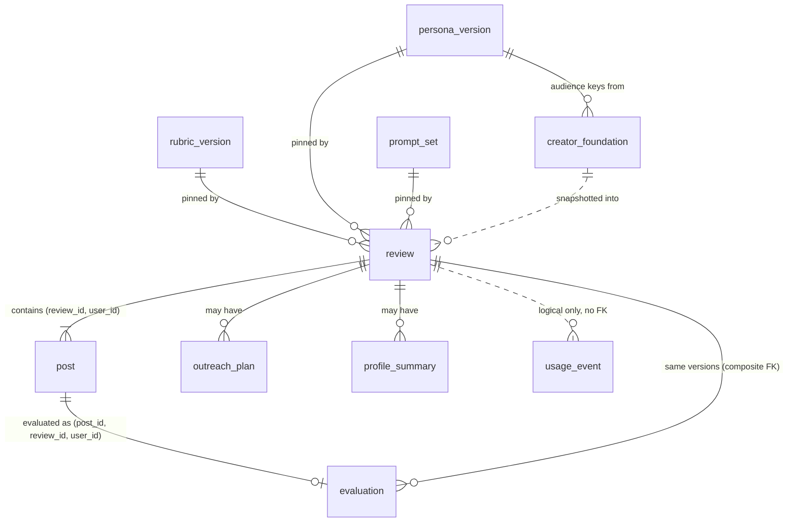

# SCHEMA: Witness Review

**Status: designed, not yet migrated (2026-10-21).**
- **Authority:** this file is the contract. Every migration that changes a table updates this file in the same change (RULES.md). Implementers never change it on their own (AGENTS.md).
- **First migration:** `supabase/migrations/<timestamp>_init.sql`, applied to the `dev` project first (AD-15).
- **Demo Artifact:** it has no database (AD-12). Only §3 (content shapes) and §4 (output contracts and validation rules) bind it.

Terms follow the PRD Glossary. AD-n references are to `ARCHITECTURE.md`.

## 1. Entity overview

| Table | Glossary term | Written by | Mutability |
|---|---|---|---|
| `rubric_version` | Rubric Version | `publish:content` | Immutable (trigger) |
| `persona_version` | Persona Version | `publish:content` | Immutable (trigger) |
| `prompt_set` | (prompt set; provenance) | `publish:content` | Immutable (trigger) |
| `creator_foundation` | Creator Foundation | server only | Editable by its owner through the server; snapshotted into each Own-Content Review |
| `review` | Review | server only (`create_review`) | Immutable (trigger); the owner may delete |
| `post` | Post | server only | Guarded transitions only (`post_guard`) |
| `evaluation` | Evaluation | server only (`record_evaluation`) | Immutable except a single on-demand rewrite (`evaluation_guard`) |
| `outreach_plan` | Ministry Outreach Plan | server only | Immutable (trigger); at most 3 per Review |
| `profile_summary` | Profile Summary | server only | Immutable (trigger); at most 3 per Review |
| `usage_event` | (spend ledger) | server only | Append-only (trigger); no FKs |



**Ownership.** Every user-owned row carries `user_id uuid not null`.
- `review.user_id` references `auth.users(id)` on delete cascade.
- **Child rows** inherit the owner through composite foreign keys (`(review_id, user_id)` or `(post_id, review_id, user_id)`), so a child can never name a different owner than its parent.
- **No FKs:** `usage_event` has no foreign keys.

## 2. Tables

### Version tables: `rubric_version`, `persona_version`, `prompt_set`

| Column | Type | Constraint |
|---|---|---|
| `id` | `text` | PK; check `id = name \|\| '@' \|\| number` |
| `name` | `text` | not null (`witness-rubric`, `persona-set`, `prompts`) |
| `number` | `int` | not null, `> 0`; `unique (name, number)` |
| `content_text` | `text` | not null; the canonical bytes (AD-1) as UTF-8 text. A prompt set holds a JSON object mapping filename to text. Renderers read this column only (AD-16) |
| `content` | `jsonb` | not null; parsed `content_text`, for queries only |
| `content_sha256` | `text` | not null; hex SHA-256 of the canonical bytes; equals the `content/published.lock.json` entry |
| `published_at` | `timestamptz` | not null default `now()` |

- **Trigger `forbid_version_change`:** raises on `BEFORE UPDATE OR DELETE` (row) and `BEFORE TRUNCATE` (statement).
- **Publishing:** all new rows are inserted in one transaction with plain `INSERT` (AD-1).

### `creator_foundation`

| Column | Type | Constraint |
|---|---|---|
| `user_id` | `uuid` | PK, FK `auth.users(id)` on delete cascade |
| `self_presentation` | `text` | not null; `char_length` between 1 and 1000 |
| `target_audiences` | `jsonb` | not null; `jsonb_typeof = 'array'`; Target Audience keys in rank order. The server checks that every key exists in `persona_version_id` and that each audience is ranked exactly once |
| `persona_version_id` | `text` | not null, FK `persona_version`; the version whose audience keys the ranking uses |
| `updated_at` | `timestamptz` | not null default `now()` |

### `review`

| Column | Type | Constraint |
|---|---|---|
| `id` | `uuid` | PK default `gen_random_uuid()` |
| `user_id` | `uuid` | not null, FK `auth.users(id)` on delete cascade |
| `kind` | `text` | not null, `in ('others','own')` |
| `is_draft_checkpoint` | `boolean` | not null default `false`; check `not is_draft_checkpoint or kind = 'own'` |
| `title` | `text` | nullable; `char_length ≤ 200` |
| `source_url` | `text` | nullable; `~* '^https?://'`, `≤ 2048`. The Profile URL (FR-2). When set, the Review is a profile Review (AD-3); it is never fetched |
| `rubric_version_id` | `text` | not null, FK `rubric_version` |
| `persona_version_id` | `text` | not null, FK `persona_version` |
| `prompt_set_id` | `text` | not null, FK `prompt_set` |
| `foundation_snapshot` | `jsonb` | check `(kind = 'own') = (foundation_snapshot is not null)`. Holds `{self_presentation, target_audiences, persona_version_id}` |
| `created_at` | `timestamptz` | not null default `now()` |

- **Unique keys:** `unique (id, user_id)` and `unique (id, rubric_version_id, persona_version_id, prompt_set_id)`.
- **Index:** `(user_id, created_at desc)`.
- **Trigger `forbid_update`:** rejects UPDATE. Delete is allowed.
- **Draft Checkpoint:** `create_review` rejects a Draft Checkpoint that does not have exactly 1 Post.

### `post`

| Column | Type | Constraint |
|---|---|---|
| `id` | `uuid` | PK |
| `review_id`, `user_id` | `uuid` | not null; FK `(review_id, user_id)` → `review(id, user_id)` on delete cascade |
| `position` | `smallint` | not null, `between 1 and 10`; `unique (review_id, position)` |
| `source_url` | `text` | nullable; `~* '^https?://'`, `≤ 2048`; never fetched |
| `pasted_text` | `text` | nullable; `≤ 4000` chars |
| `video_transcript` | `text` | nullable; `≤ 20000` chars |
| `image_count` | `smallint` | not null default `0`, `between 0 and 4` |
| `post_transcript` | `text` | nullable; written only by `record_evaluation` |
| `status` | `text` | not null default `'pending'`, `in ('pending','evaluating','done','failed','refused')` |
| `attempt` | `smallint` | not null default `0`, `between 0 and 3` |
| `claimed_at` | `timestamptz` | nullable |
| `created_at` | `timestamptz` | not null default `now()` |

- **Content check:** `pasted_text is not null or video_transcript is not null or image_count > 0`.
- **Unique key:** `unique (id, review_id, user_id)`.
- **Unpublished Post:** a Post is an Unpublished Post when its Review `is_draft_checkpoint`.
- **Trigger `post_guard`:** UPDATE may change only:
  - `status`, along the AD-10 transitions;
  - `attempt` and `claimed_at`;
  - `post_transcript`, from null to a value, once.
- **No image column exists, by design (AD-5).**

### `evaluation`

| Column | Type | Constraint |
|---|---|---|
| `id` | `uuid` | PK |
| `post_id`, `review_id`, `user_id` | `uuid` | not null; `unique (post_id)`; FK `(post_id, review_id, user_id)` → `post(id, review_id, user_id)` on delete cascade |
| `rubric_version_id`, `persona_version_id`, `prompt_set_id` | `text` | not null; FK `(review_id, rubric_version_id, persona_version_id, prompt_set_id)` → `review` on delete cascade |
| `models` | `jsonb` | not null; `{assess, react, discuss, rewrite?}`, the answering model ids |
| `assessment` | `jsonb` | not null; `AssessOutput` minus `post_transcript`, after overrides and redaction |
| `reactions` | `jsonb` | not null; `ReactOutput` |
| `discussion_questions` | `jsonb` | not null; `DiscussOutput` |
| `gentler_rewrite` | `jsonb` | nullable; `{output: RewriteOutput, model_id, created_at}` |
| `lands_well` | `boolean` | not null; derived once (AD-3) |
| `rewrite_mode` | `text` | not null, `in ('auto','offer','none','not_assessable')`; derived once (AD-3) |
| `rewrite_requested_at` | `timestamptz` | nullable; the atomic claim for the on-demand Rewrite |
| `created_at` | `timestamptz` | not null default `now()` |

- **`gentler_rewrite`:** check `rewrite_mode <> 'auto' or gentler_rewrite is not null`. An auto rewrite is inserted with the row.
- **Trigger `evaluation_guard`:** UPDATE is allowed only when two conditions hold:
  1. `to_jsonb(NEW) - 'gentler_rewrite' - 'rewrite_requested_at'` equals the same expression on OLD;
  2. `gentler_rewrite` goes from null to a value only when `OLD.rewrite_mode = 'offer'`.

### `outreach_plan`

| Column | Type | Constraint |
|---|---|---|
| `id` | `uuid` | PK |
| `review_id`, `user_id` | `uuid` | not null; FK `(review_id, user_id)` → `review(id, user_id)` on delete cascade |
| `model_id` | `text` | not null; the answering model |
| `outreach_message` | `text` | not null |
| `talking_points` | `jsonb` | not null; `OutreachOutput.talking_points` (§4.5) |
| `created_at` | `timestamptz` | not null default `now()` |

- **Rules:** `forbid_update` trigger. The Review must be `kind = 'others'`. At most 3 rows per Review, counted by the gate (AD-8). The UI shows the latest.

### `profile_summary`

| Column | Type | Constraint |
|---|---|---|
| `id` | `uuid` | PK |
| `review_id`, `user_id` | `uuid` | not null; FK `(review_id, user_id)` → `review(id, user_id)` on delete cascade |
| `model_id` | `text` | not null |
| `stats` | `jsonb` | not null; code-computed (§4.6), includes `post_ids` |
| `narrative` | `jsonb` | not null; model output (§4.6) |
| `created_at` | `timestamptz` | not null default `now()` |

- **Rules:** `forbid_update` trigger. At most 3 rows per Review.

### `usage_event`

| Column | Type | Constraint |
|---|---|---|
| `id` | `bigint` | PK, generated always as identity |
| `user_id` | `uuid` | **no FK**; not null for every step |
| `review_id` | `uuid` | **no FK**; not null when `step = 'review_created'` |
| `post_id` | `uuid` | **no FK**; nullable |
| `step` | `text` | not null, `in ('review_created','assess','react','discuss','rewrite','outreach','profile_summary')` |
| `model_id` | `text` | nullable; the final answering model; null for `review_created` |
| `outcome` | `text` | not null, `in ('ok','invalid_model_output','refused','upstream_error','estimated')`. `estimated` means the call threw without usage and was charged at its worst case |
| `input_tokens`, `cache_creation_input_tokens`, `cache_read_input_tokens`, `output_tokens` | `int` | not null default `0`; summed across `usage.iterations` |
| `cost_usd` | `numeric(10,6)` | not null default `0`; each iteration priced at its own model (AD-8) |
| `created_at` | `timestamptz` | not null default `now()` |

- **Indexes:** `(created_at)` and `(user_id, step, created_at)`.
- **Trigger `forbid_ledger_change`:** raises on UPDATE, DELETE and TRUNCATE.

### SQL functions (AD-9)

Both functions are `security definer` with a fixed `search_path`.

**`create_review(uid uuid, review jsonb, posts jsonb) returns uuid`.** In one transaction, it:
1. takes `pg_advisory_xact_lock(hashtext(uid::text))`;
2. counts `review_created` in the rolling 24 h (raising `daily_cap_reached` at ≥ 3);
3. selects the latest version triple in one statement;
4. snapshots the Creator Foundation for `kind = 'own'`, raising `foundation_required` if there is none;
5. inserts the Review, its Posts and the `review_created` ledger row.

**`record_evaluation(uid uuid, post_id uuid, post_transcript text, evaluation jsonb) returns uuid`.** In one transaction, it inserts the Evaluation and sets `post_transcript` and `status = 'done'`. It verifies that the Post belongs to `uid` and is `evaluating`.

**Privileges:** `revoke execute on function … from public, anon, authenticated; grant execute … to service_role`.

## 3. Content file shapes (`content/`, both surfaces)

```jsonc
// content/rubric/witness-rubric@1.json
{
  "id": "witness-rubric@1", "name": "witness-rubric", "number": 1,
  "scale": { "min": 1, "max": 5, "na": true },
  "thresholds": { "lands_well_min": 3, "auto_rewrite_below": 3, "offer_rewrite_at": 3 },
  "criteria": [
    { "key": "outsider_clarity", "number": 1, "name": "Outsider Clarity",
      "scores_whether": "can be understood by someone with no church background; …",
      "guidance": { "1": "…", "3": "…", "5": "…" },
      "applies_to": "all" },
    { "key": "self_presentation_alignment", "number": 10, "name": "Self-Presentation Alignment",
      "scores_whether": "…", "guidance": { "…": "…" },
      "applies_to": "own_content",
      "na_reason_others": "Applies only when Creators review their own posts." }
  ]
}

// content/personas/persona-set@1.json
{
  "id": "persona-set@1", "name": "persona-set", "number": 1,
  "personas": [                          // array order = default display order (AD-3)
    { "key": "seeker", "name": "Seeker", "summary": "…",
      "card": "markdown: background, named sub-culture, cultural touchpoints, narratives, longings, reasons for their views",
      "frame": "non_believer" }          // "believer_behaviour" for emboldened_believer (FR-8)
  ],
  "target_audiences": [                  // FR-10; rule and labels approved via bmad-ux (OQ-6)
    { "key": "curious",      "label": "Reach people curious about faith",                 "lead_personas": ["seeker", "drifter"] },
    { "key": "dechurched",   "label": "Reach people who've drifted from or left church",  "lead_personas": ["drifter", "exvangelical", "progressive"] },
    { "key": "other_faiths", "label": "Reach people of other faiths or spiritualities",   "lead_personas": ["neighbor_other_faith", "seeker"] },
    { "key": "secular",      "label": "Reach skeptical or secular people",                "lead_personas": ["skeptic", "progressive"] },
    { "key": "believers",    "label": "Build up existing Christians",                     "lead_personas": ["emboldened_believer", "exvangelical", "drifter"] }
  ]
}

// content/prompts/prompts@1/manifest.json
{
  "id": "prompts@1",
  "steps": {
    "assess":          { "file": "assess.md",          "placeholders": ["guardrails", "criteria", "foundation", "post"], "required_rules": ["…"] },
    "react":           { "file": "react.md",           "placeholders": ["guardrails", "personas", "post"],              "required_rules": ["…"] },
    "discuss":         { "file": "discuss.md",         "placeholders": ["guardrails", "criteria", "personas", "post", "assessment", "reactions"], "required_rules": ["…"] },
    "rewrite":         { "file": "rewrite.md",         "placeholders": ["guardrails", "criteria", "personas", "post", "assessment", "reactions"], "required_rules": ["…"] },
    "outreach":        { "file": "outreach.md",        "placeholders": ["guardrails", "evaluations"], "required_rules": ["…"] },
    "profile_summary": { "file": "profile-summary.md", "placeholders": ["guardrails", "stats", "evaluations"], "required_rules": ["…"] }
  },
  "guardrails": { "file": "guardrails.md", "required_rules": ["…"] }
}

// content/published.lock.json
{ "witness-rubric@1": "<sha256>", "persona-set@1": "<sha256>", "prompts@1": "<sha256>" }
```

## 4. Model-output contracts (both surfaces; AD-4)

### 4.1 `AssessOutput`
```jsonc
{
  "post_transcript": "string",          // the Post's own caption + on-screen text only (AD-5)
  "scores": [
    { "criterion": "outsider_clarity",
      "score": 4,                        // integer 1–5, or null for N/A
      "evidence": "string | null",       // quote, or a description of a screenshot region
      "explanation": "string",           // one plain sentence; for N/A, why it does not apply
      "offence_sources": ["tone"] }      // subset of ["claim", "tone", "jargon"]
  ],
  "soundness_flag": null                 // or { "line": "string", "why": "string" }
}
```

### 4.2 `ReactOutput`
```jsonc
{ "reactions": [ { "persona": "seeker", "felt_response": "confused",
                   "valence": "positive | negative | mixed",
                   "reasons": ["string"] } ] }
```

### 4.3 `DiscussOutput`
```jsonc
{ "questions": [ { "text": "string",
                   "standing": "done_differently | bible_says | jesus_responded | jesus_posted | null",
                   "persona": "persona key | null" } ] }   // persona set when the question cites a Persona (simulated label, AD-14)
```

### 4.4 `RewriteOutput`
```jsonc
{ "rewrite": "string", "changes": ["string"] }
```

### 4.5 `OutreachOutput`
```jsonc
{ "outreach_message": "string",
  "talking_points": [ { "post_position": 1, "criterion": "outsider_clarity",
                        "kind": "affirmation | concern", "text": "string",
                        "change": "string | null", "persona": "persona key | null" } ] }
```

### 4.6 Profile Summary
- **`stats`** (code-computed, AD-3):
  - `post_ids`
  - `post_count`
  - `criterion_averages {key: number|null}`
  - `posts_with_offence_source {claim, tone, jargon}`
  - `posts_below_3 {key: count}`
  - `persona_valence {persona: {positive, negative, mixed}}`
  - `strongest_post` and `weakest_post` (positions)
- **`narrative`** (model): `{ "patterns": ["string"], "top_changes": ["string"] }`

### 4.7 Validation rules (bind both validators; AD-4, AD-16)

| Rule | Applies to |
|---|---|
| Objects are strict. Unknown keys reject (`z.strictObject`; the hand validator does the same) | every contract |
| `scores` covers exactly the pinned rubric's Criterion keys, in rubric order, with no duplicates | Assess |
| `score` is an integer 1–5, or null | Assess |
| `evidence` is a non-empty string if and only if `score` is not null | Assess |
| `offence_sources` is empty when `score` is null and non-empty when `score ≤ 3`. It may be non-empty at 4–5, so claim offence is still reported. A `score < 3` must include `tone` or `jargon`: claim alone never lowers a score (FR-4) | Assess |
| `explanation` is a non-empty string | Assess |
| `reactions` covers exactly the Persona keys, in any order, with no duplicates. `reasons` holds 1–3 non-empty strings | React |
| `questions` holds 4–6 items. Each `standing` key appears exactly once; the rest are null. `persona` is a Persona key or null | Discuss |
| `rewrite` is non-empty. `changes` holds 1–5 strings | Rewrite |
| `talking_points` holds 3–5 items. `post_position` is a done Post of this Review. `criterion` is a rubric key. `change` is required when `kind = concern`. At most 3 `concern` items | Outreach |
| `patterns` holds 1–5 strings and `top_changes` holds 2–3 | Profile Summary |
| **Artifact extraction:** take the JSON substring from the first `{` to the last `}`. Nothing else is stripped | Artifact |
| **After validation:** run the overrides (AD-3), then `redactHandles` over every string (AD-5), then derive | both surfaces |

**Additive contracts.** New fields go at the end and are optional. No field is renamed, retyped or removed. A breaking change ships with a new `prompts@n` (AD-4).

## 5. Access control (RLS)

Every table has RLS enabled, with its policies in the same migration. Own means `user_id = (select auth.uid())`:
- in `using` for select, update and delete;
- in `with check` for insert and update.

The secret key, used by server code only, bypasses RLS. Writes are server-only (AD-9).

| Table | `anon` | `authenticated` |
|---|---|---|
| `rubric_version`, `persona_version`, `prompt_set` | none | select: `true` |
| `creator_foundation`, `review`, `post`, `evaluation`, `outreach_plan`, `profile_summary` | none | select own |
| `usage_event` | restrictive deny-all policy, plus `revoke all` | restrictive deny-all policy, plus `revoke all` |

Users never insert, update or delete through the Data API. Review deletion is a Server Action that deletes with `user_id = <verified uid>` (AD-9), and the cascade removes its children.

## 6. Off-store state

- **`content/`** is the source of truth for every version. `content/published.lock.json` locks published ids (AD-1). `conformance/` holds the shared test vectors (AD-16). `config/models.json` holds the only model ids and prices (AD-7).
- **Supabase projects:** two free projects (AD-15).
  - `dev`: development, agents and tests.
  - `prod`: Vercel Production only.

  Neither has Storage buckets. The Free plan has no automatic backups, and Bennett takes a `supabase db dump` before a demo.
- **Vercel Production environment only:**
  - `ANTHROPIC_API_KEY`, for a dedicated Anthropic workspace with a $30 monthly spend limit confirmed in the Console;
  - `SUPABASE_SECRET_KEY` (`sb_secret_…`);
  - `REVIEWS_ENABLED`, unset by default;
  - `CLAUDE_ADAPTER=live`.

  Public on every environment: `NEXT_PUBLIC_SUPABASE_URL` and `NEXT_PUBLIC_SUPABASE_PUBLISHABLE_KEY` (`sb_publishable_…`). Preview has no secrets.
- **Local `.env.local`:** dev-project keys and `CLAUDE_ADAPTER=fake`. No Anthropic key.
- **Constants in code:**
  - `src/server/claude/model.ts`: `CLAUDE_EFFORT`, `FALLBACK_BETA` and the per-step `max_tokens`.
  - `src/server/gate/`: `MONTHLY_SPEND_CAP_USD = 25`, `DAILY_REVIEW_CAP = 3`, `MAX_POSTS_PER_REVIEW = 10`, `MAX_IMAGES_PER_POST = 4`, `MAX_ATTEMPTS_PER_POST = 3` and `MAX_REGENERATIONS_PER_REVIEW = 3`.
- **Supabase Auth (prod):** email provider on; "Allow new users to sign up" off. Bennett creates users with Auto Confirm (AD-11). New projects use asymmetric JWT signing keys, so `getClaims()` verifies locally.
- **Screenshots:** they exist only in the browser and in the evaluate request body. They are never stored and never rendered as images (AD-5).
- **Demo Artifact:**
  - Reviews live in page memory; `localStorage` holds only the theme preference.
  - The platform's `sample` answer cache lasts 5 minutes per viewer and browser. It is bypassed with `cache: false` on Try again.

## 7. Migrations

- **Location:** `supabase/migrations/`, written with `supabase migration new` and applied with `supabase db push`, to `dev` by default.
- **Pushing to prod:** Bennett pushes to `prod`, or an agent does with his OK in chat, before the code that needs the migration reaches `main` (AD-15).
- **First migration:** creates every table, check, index, trigger and function above, and every RLS policy and grant, in the same file.
- **Content is not a migration.** Version rows come from `npm run publish:content`, to `dev` by default and to `--prod` by Bennett.
- **Append-only:** once applied, a migration is never edited. To change it, write a new one.

## Keeping this true

This file is the contract (RULES.md; AGENTS.md: implementers never change it on their own).
- Columns and output-contract fields are fixed. New ones are added at the end, in the same change as the migration that adds them.
- If a migration and this file disagree, stop and ask Bennett. Do not regenerate either side to match the other.
